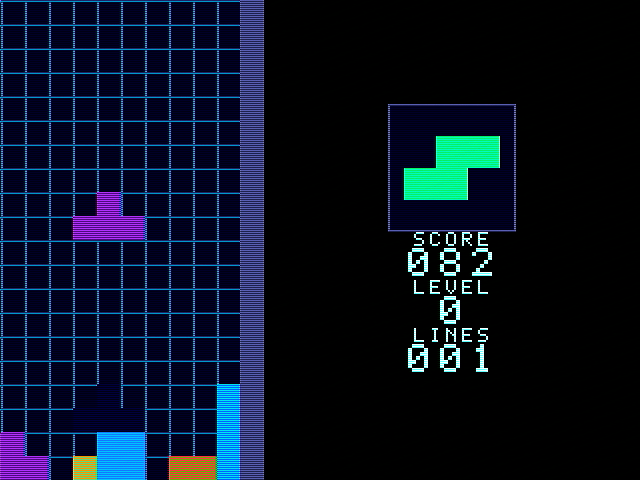

# VGA 俄罗斯方块（Basys3 / Artix-7）

用一块 **Basys3（XC7A35T）** 从零实现的 VGA 俄罗斯方块，核心逻辑全部为手写 Verilog，
不依赖任何 IP。画面 640×480@60 Hz（逻辑分辨率 320×240、12 位 16 色），
板载五键 + 三个拨码操作，数码管实时显示分数。



## 功能

- 7-bag 随机出块，旋转使用居中掩码 + 列偏置，可贴到最左/最右列
- 软降、硬降、落地锁定（两拍流水）、消 1~4 行、计分与等级（重力随等级加快）
- 落点虚影、消行白闪、扫描线压暗
- NEXT 预览、分数/等级/行数面板、START / PAUSE / GAME OVER 提示
- 板级自检：1 Hz 心跳灯、复位指示、按键状态/事件灯

## 硬件与显示

| 项 | 参数 |
| --- | --- |
| 开发板 | Digilent Basys3（Xilinx Artix-7 XC7A35T-1CPG236C） |
| 工具链 | Vivado 2019.1 |
| 时钟 | 100 MHz |
| 显示 | 640×480@59.5 Hz VGA，12 位色（4-4-4），16 色调色板 |
| 逻辑分辨率 | 320×240，游戏区 10×20 格 |
| 输入 | `btnL/R` 左右、`btnU` 旋转、`btnD` 软降、`btnC` 硬降；`sw[12]` 开始、`sw[13]` 重开、`sw[14]` 暂停、`sw[15]` 复位 |

## 仓库结构

```
.
├── src/         20 个 RTL 源文件（纯 Verilog，无 IP）
├── tb/          13 个自检测试平台
├── constrs/     basys3_top.xdc（引脚与 100 MHz 时钟约束）
├── doc/         实验报告、图片素材
├── ip/          （空，本设计未使用 IP）
└── sim/         仿真脚本与交付物
```


## 模块划分

| 层 | 模块 | 作用 |
| --- | --- | --- |
| 时序层 | `vga_timing` | 行/场计数、同步、`pixel_ce`、`frame_tick` |
| 逻辑层 | `input_subsystem` / `btn_sync` / `debounce` / `key_repeat` | 按键同步、去抖、DAS/ARR 连发 |
| 逻辑层 | `piece_random` | 7-bag 随机 |
| 逻辑层 | `shape_rom` | 28 个 4×4 方块掩码 |
| 逻辑层 | `tetris_core` | 场地、碰撞、旋转、锁定、消行、计分、等级 |
| 显示层 | `cell_map` | 像素坐标 → 格子索引 + 格内偏移 |
| 显示层 | `render` | 井内优先级仲裁 |
| 显示层 | `panel` / `font_rom` / `fontlay` | NEXT、分数面板、文字层与字库 |
| 显示层 | `palette` / `video_pipe` | 调色板、两级视频流水 |
| 顶层 | `top_tetris` | 只含例化与连线 |

三个状态机：会话（IDLE/PLAY/PAUSE/OVER）、相位（FALL/TOUCH/DROP/LOCK/WRITE/SETTLE）、
消行（IDLE/FLASH/COLL/FILL）。

## 仿真验证

13 个 testbench 在 Vivado 2019.1 下全部通过：

| testbench | 覆盖 | 检查数 |
| --- | --- | --- |
| `tb_tetris_core` | 11 个定向用例（复位/开始/重力/落地/消 1 行/消 4 行/左右边界/堆到顶/暂停/重开） | 68 |
| `tb_bias_range` | 28 个朝向的偏置坐标穷举 | 56 |
| `tb_font_rom` | 37 个字形 + 每字第 7 行全 0 | 74 |
| `tb_panel` | 面板 ASCII、x<132 无内容、NEXT 边框 | 35 |
| `tb_fontlay` | START / PAUSE / GAME OVER 与压暗 | 7 |
| `tb_piece_random` | 100 包 7-bag 性质 | 1401 |
| `tb_frame` | 整帧抓取、场周期与像素数 | 307200 pixels |
| `tb_shape_rom` | 28 个掩码点阵 | 28 |
| `vga_timing_tb` | 整帧 de 计数与同步极性 | 1266870 |
| `cell_map_tb` | 整帧坐标映射 | 307208 |
| `shape_rom_tb` | 28 个掩码断言 | 67 |
| `palette_tb` | 16 色调色板 | 17 |
| `render_tb` | 优先级仲裁定向用例 | 1613 |


## 资源与性能（impl_2，Vivado 2019.1）

| 项 | 数值 |
| --- | --- |
| LUT | 6053 / 20800（29.10%） |
| FF | 1770 / 41600（4.25%） |
| LUTRAM / BRAM / DSP | 0 / 0 / 0 |
| IO | 53 / 106（50%） |
| Setup WNS | +0.021 ns（TNS 0，失败端点 0） |
| 片上功耗 | 0.128 W（Dynamic 0.056 W + Static 0.072 W） |

## 如何打开 / 重建工程
手动新建工程：选 `xc7a35tcpg236-1`，把 `src/*.v` 加入 Design Sources、
`constrs/basys3_top.xdc` 加入 Constraints、`tb/*.v` 加入 Simulation Sources，
顶层设为 `top_tetris`。

## 文档

- 实验报告：`doc/实验报告—基于Basys3的VGA俄罗斯方块.md`（含设计、验证、时序收敛与上板记录）
- 报告图片：`doc/img/`

## 下载

- 源码：`git clone https://github.com/c-promise-n/vga-game-tetris.git`
- 完整 Vivado 工程（含 `.xpr` 与本地生成的 `work/`）：见仓库 **Releases** 页的 zip 附件；


## 已知限制

- 旋转只做了简化踢墙，贴墙时可能转不动，手感不如商业实现
- 无 HOLD、无第二个 NEXT 预览、无音效
- 时序余量偏薄（Setup +0.021 ns），再改 RTL 需要重新收敛


---

### English

A from-scratch VGA Tetris on Digilent Basys3 (Artix-7 XC7A35T), written in plain Verilog
without any IP. 640×480@60 Hz VGA, 7-bag randomizer, rotation, soft/hard drop, ghost piece,
line clear, scoring/levels, NEXT preview, on-board buttons and 7-segment score display.
13 self-checking testbenches pass on Vivado 2019.1.
