# 荣誉课作业4 实验报告：基于 Basys3 的 VGA 俄罗斯方块

| 项目 | 内容 |
| --- | --- |
| 姓名 | 陈诺 |
| 学号 | 25303040030 |
| 开发工具 | Vivado 2019.1 |
| 开发板 | Digilent Basys3（Artix-7 XC7A35T-1CPG236C） |
| 工程 | `vga_game_tetris.xpr` |
|GitHub仓库|https://github.com/c-promise-n/vga-game-tetris.git|
|演示视频|https://www.bilibili.com/video/BV1uUW166EkE?t=27.0|

## 一、实验内容
### 1.1 实验要求

本次荣誉课作业要求任选 1 个有现成代码的数字系统进行实现以及改进，也可自行设计一个数字系统，用 FPGA 开发板验证，且禁止完全照抄已有的数字系统代码，需要有自已的思考与加工。
### 1.2 选题与改进目标

参考系统选用 Digilent 官方 Basys3 的 VGA 显示例程。该例程只产生 640×480 的同步时序，并在有效区域内输出固定的彩条；它没有可寻址的像素坐标、没有调色板、没有帧同步信号，无法直接支撑交互式应用。

在此基础上本设计实现俄罗斯方块，理由有四条：

- 显示链路可以复用，VGA 例程已经解决了同步时序这个最容易出错的部分；
- 游戏逻辑的耦合度高，旋转、踢墙、碰撞、消行、计分、等级互相牵连，改一处会影响别处；
- 正确性判据明确，消行是否消除、碰撞是否阻挡、边界是否可达、等级是否按时升级，都可以用仿真和数据验证；
- 需要实时输入，五个按键加三个拨码开关，能完整设计一遍去抖、边沿检测、连发（DAS/ARR）链路。

相对参考例程的改进如表 1。

**表 1　本设计相对参考 VGA 例程的改进**

| 方面 | 参考 VGA 例程 | 本设计 |
| --- | --- | --- |
| 像素寻址 | 无，只能输出固定彩条 | 320×240 可寻址逻辑像素 |
| 色彩 | 3 位（8 色） | 12 位，16 色调色板 |
| 帧同步 | 无 | `frame_tick`，每帧一个单拍脉冲 |
| 像素节拍 | 按 100 MHz 逐拍推进 | `pixel_ce` 四分频，25 MHz 像素节拍 |
| 游戏逻辑 | 无 | 完整俄罗斯方块（旋转/踢墙/消行/计分/等级） |
| 方块生成 | 无 | 7-bag 随机，保证七种方块均匀出现 |
| 输入 | 无 | 5 按键 + 3 拨码，去抖 + 边沿 + DAS/ARR 连发 |
| 显示内容 | 彩条 | 井、网格、方块、虚影、NEXT 面板、数字、文字提示、扫描线 |
| 时序约束 | 未约束 | 100 MHz 约束下实现收敛（Setup +0.021 ns） |
| 顶层结构 | 单文件 | 20 个模块，顶层只含例化与连线 |
### 1.3 系统总体结构

整机按"谁产生节拍 / 谁决定内容 / 谁负责画"分成三层，每层只依赖下一层的输出，不反向依赖，结构如图 1 所示。

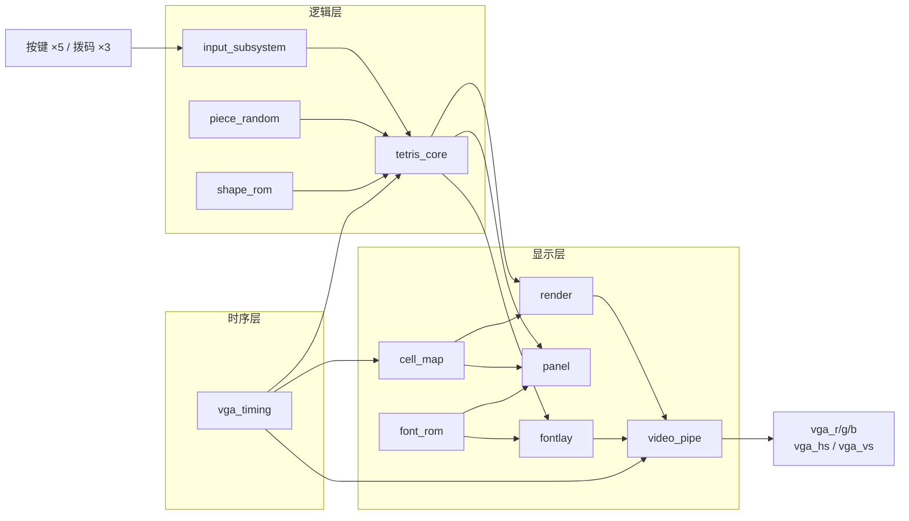


**图 1　系统顶层框图**

三层的数据流如表 2。

**表 2　三层数据流**

| 层次 | 包含模块 | 输入 | 输出 |
| --- | --- | --- | --- |
| 时序层 | `vga_timing` | `clk`、`rst_n` | `px`、`py`、`de`、`hsync`、`vsync`、`pixel_ce`、`frame_tick` |
| 逻辑层 | `tetris_core`、`piece_random`、`shape_rom`、`input_subsystem` | `frame_tick`、`key_edge`、`key_pressed` | 场地、方块位置、分数、等级、行数、状态标志 |
| 显示层 | `cell_map`、`render`、`panel`、`fontlay`、`video_pipe`、`palette` | `px`、`py`、逻辑层输出 | `vga_r/g/b`、`vga_hs/vs` |

分层的收益是可测试性：显示层可以脱离游戏逻辑单独验证，游戏核心也可以用一个只打印场地内容的 testbench 单独验证，不需要接显示器。开发过程中曾把某个颜色索引固定输出，使整条视频链路在不接入游戏逻辑的情况下单独跑通。
### 1.4 时钟、复位与节拍

整个设计只使用一个 100 MHz 时钟，所有时序逻辑同处一个时钟域，不同速率的部分靠使能信号而不是分频时钟来区分节拍。

- **`pixel_ce`**：一个 2 位计数器从 0 数到 3 循环，等于 3 时拉高一拍。所有像素相关计数（`hcount` / `vcount`）只在它有效的那一拍推进，等效于 25 MHz；
- **`frame_tick`**：`pixel_ce` 与 `hcount==0` 与 `vcount==0` 同时成立时拉高一拍，代表一帧的开始。重力、锁定延迟、闪白计时都以它为节拍；
- **复位**：`rst_n` 由拨码开关 `sw[15]` 取反得到，异步复位、低电平有效。上电后 `sw[15]` 必须拨下，设计才退出复位。

没有给游戏逻辑单独做 60 Hz 时钟，原因是那样会引入跨时钟域。使用 `frame_tick` 使能，所有寄存器仍在同一个 100 MHz 时钟域，只是每帧才更新一次，既避免了跨时钟域，也让时序分析只需要针对一个时钟。

这样做的代价是同一个模块里同时存在每拍和每帧两种节拍，写代码时必须清楚每一行属于哪一种。
### 1.5 设计指标

**表 3　系统设计指标**

| 项目 | 指标 |
| --- | --- |
| 显示分辨率 | 640×480 |
| 场频 | 25 MHz ÷ (800 × 525) = 59.52 Hz |
| 逻辑分辨率 | 320×240，1 逻辑像素 = 2×2 物理像素 |
| 色深 | 12 位，16 色调色板 |
| 游戏区 | 10 列 × 20 行，每格 12 逻辑像素 |
| 重力档位 | 4 档，30 / 22 / 16 / 10 帧每格 |
| 输入 | 5 按键 + 3 拨码，去抖 + 边沿 + DAS/ARR |
| 时序 | 100 MHz 约束下 WNS ≥ 0 |
| 资源 | LUT 占用远低于 20800 |
## 二、模块设计
### 2.1 三个状态机

整机有三个独立的状态机，它们不是并列的，而是串联驱动的关系，如图 2。

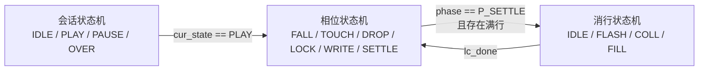


**图 2　三个状态机的驱动关系**

| 状态机 | 状态数 | 节拍 | 作用 |
| --- | --- | --- | --- |
| 会话状态机 | 4（IDLE / PLAY / PAUSE / OVER） | 每拍（组合求次态） | 决定游戏是否处于可操作状态 |
| 相位状态机 | 6（FALL / TOUCH / DROP / LOCK / WRITE / SETTLE） | 帧与拍混用 | 决定当前方块的推进与锁定 |
| 消行状态机 | 4（IDLE / FLASH / COLL / FILL） | 每拍，闪白按帧计时 | 决定场地的整理与消除 |

**表 4　三个状态机的职责划分**

会话状态机是总闸，只有 `cur_state == PLAY` 时相位状态机才推进，因此"方块可操作"这个条件同时包含两者：

```verilog
wire piece_active = (cur_state == PLAY) && ((phase == P_FALL) || (phase == P_TOUCH));
```

消行状态机由相位状态机启动：相位状态机走到 `P_SETTLE` 时检查是否存在满行，有则拉高 `lc_start`；消行完成后用 `lc_done` 通知相位状态机生成新方块。这是整台设计里唯一一处反向驱动。
#### 2.1.1 会话状态机

```verilog
wire pause_level = key_pressed[5];                    // sw[14]，电平
wire start_pulse = key_edge[7] | key_edge[6];         // sw[12] / sw[13]
// 从 OVER 按按钮继续；sw[13] 任意时刻都能重开
wire restart_now = key_edge[6] | ((cur_state == OVER) && key_edge[4]);
wire do_start    = start_pulse && (cur_state == IDLE);

always @(*) begin
    next_state = cur_state;
    case (cur_state)
    IDLE:  if (do_start)     next_state = PLAY;
    PLAY:  if (pause_level)  next_state = PAUSE;
           else if (game_over) next_state = OVER;
    PAUSE: if (!pause_level) next_state = PLAY;
    OVER:  if (restart_now)  next_state = PLAY;
    default: next_state = IDLE;
    endcase
end
```

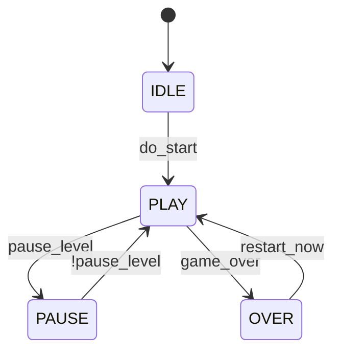


**图 3　会话状态机**

**表 5　会话状态机的转移条件**

| 状态 | 进入条件 | 出口条件 | 该状态下的行为 |
| --- | --- | --- | --- |
| IDLE | 复位 | `sw[12]` / `sw[13]` 上升沿->PLAY | 显示 START，场地清空 |
| PLAY | 开始 / 继续 / 重开 | `sw[14]` 拨上->PAUSE；堆到顶->OVER | 正常游戏 |
| PAUSE | `sw[14]` 处于高电平 | `sw[14]` 拨下 | 冻结相位状态机，画面压暗,显示PAUSE |
| OVER | `game_over` | OVER 状态下按 `btnC`，或 `sw[13]`上升沿 | 显示 GAME OVER |

暂停输入取电平、方向键取单拍脉冲，两者的区分见表 13；PAUSE 的出口条件是 `!pause_level`。这两处判断的理由见 3.4。
#### 2.1.2 相位状态机

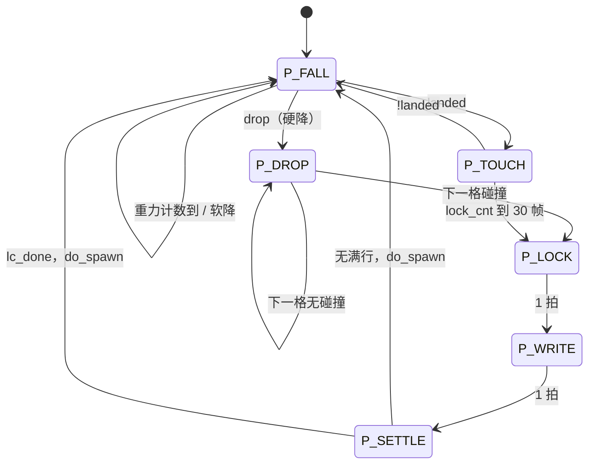


**图 4　相位状态机**

**表 6　相位状态机的状态与时长**

| 状态 | 停留时长 | 做什么 | 出口条件 |
| --- | --- | --- | --- |
| `P_FALL` | 等重力 | 正常下落，响应左/右/旋转/软降/硬降 | 每 `GRAV` 帧下移一格；`landed` 则转 `P_TOUCH`；`drop` 则转 `P_DROP` |
| `P_TOUCH` | 最多 `lock_delay` = 30 帧 | 允许玩家贴地后微调 | 30 帧内没动则转 `P_LOCK`；方块被挪开则回 `P_FALL` |
| `P_DROP` | 每拍一格 | 硬降：逐拍下移直到碰撞 | 碰撞时转 `P_LOCK` |
| `P_LOCK` | 1 拍 | 把方块的 4 行移位、展开颜色，写进 `lock_row` / `lock_type` | 立即转 `P_WRITE` |
| `P_WRITE` | 1 拍 | 只用寄存器把 `lock_row` 或进场地 | 转 `P_SETTLE` |
| `P_SETTLE` | 等消行完成 | 检查满行，决定启动消行还是生成新方块 | `lc_state==L_IDLE && !lc_issued` |
#### 2.1.3 消行状态机

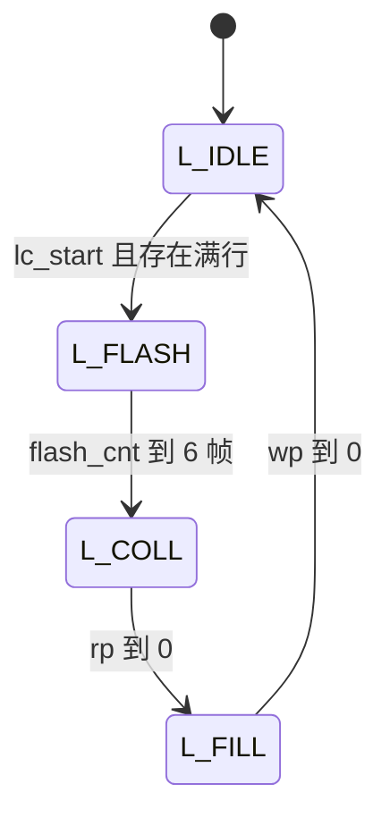


**图 5　消行状态机**

**表 7　消行状态机的状态与时长**

| 状态 | 时长 | `rp` / `wp` 变化 | 输出 |
| --- | --- | --- | --- |
| `L_IDLE` | 等 `lc_start` | 都置 19 | — |
| `L_FLASH` | 6 帧（约 100 ms） | 不变 | `flash_rows = full_lat` |
| `L_COLL` | 20 拍 | `rp` 每拍减 1；非满行时 `wp` 也减 1 | — |
| `L_FILL` | 至 `wp == 0` | `wp` 每拍减 1 | `lc_done` |
### 2.2 VGA 时序与像素节拍

VGA 的 640×480 时序由行、场两组计数器产生，参数如表 8。

**表 8　VGA 时序参数**

| 参数 | 值 | 含义 |
| --- | --- | --- |
| `hpixel_end` | 799 | 一行共 800 个像素时钟（0~799） |
| `hdat_begin` | 144 | 有效像素起点 = 行同步 96 + 后沿 48 |
| `hdat_end` | 784 | 有效像素终点，共 640 个有效像素 |
| `vline_end` | 524 | 一场共 525 行（0~524） |
| `vdat_begin` | 35 | 有效行起点 = 场同步 2 + 后沿 33 |
| `vdat_end` | 515 | 有效行终点，共 480 个有效行 |

```verilog
reg [1:0] cnt;
always @(posedge clk or negedge rst_n) begin
    if (!rst_n) cnt <= 2'b0;
    else        cnt <= cnt + 1'b1;
end
assign pixel_ce = (cnt == 2'd3);

reg [9:0] hcount, vcount;
always @(posedge clk or negedge rst_n) begin
    if (!rst_n)              hcount <= 10'b0;
    else if (pixel_ce) begin
        if (hcount == hpixel_end) hcount <= 0;
        else                      hcount <= hcount + 1'b1;
    end
end

assign de = (hcount >= hdat_begin) && (hcount < hdat_end) &&
            (vcount >= vdat_begin) && (vcount < vdat_end);
assign px = de ? (hcount - hdat_begin) : 10'd0;
assign py = de ? (vcount - vdat_begin) : 10'd0;
```

`px` / `py` 只在 `de` 有效时输出真实坐标，无效区域强制为 0，下游在消隐期会按坐标 0 计算颜色，但被 `video_pipe` 用 `de` 钳成黑色，不会留下残影。场频为 25 MHz ÷ (800 × 525) = 59.52 Hz。
### 2.3 场地表示与碰撞检测
#### 2.3.1 双层位图

```verilog
reg [9:0]  field_occ  [0:19];   // 10 位，每格 1 位：是否被占
reg [29:0] field_type [0:19];   // 30 位，每格 3 位：方块类型（决定颜色）
```

I 型方块的类型编码为 0，如果只用一个 3 位数组，"类型 0 的格子"与空格子无法区分，因此必须有一个独立的存在位。

颜色模板在类型变化时寄存一次，而不是每次锁定都组合展开：

```verilog
// p_type 只在 do_spawn / 复位时变化，所以展开成十格的颜色模板只需在变化时做一次
reg [29:0] type_pat;
always @(posedge clk or negedge rst_n) begin
    if (!rst_n)                        type_pat <= 30'd0;
    else if (type_pat != {10{p_type}}) type_pat <= {10{p_type}};
end

// 把 10 位占位掩码摊成每格 3 位（3'b111 或 3'b000）。
// 三位的值永远相同，所以这纯粹是连线，不消耗 LUT
function [29:0] type_spread;
    input [9:0] occ_mask;
    integer i;
    begin
        type_spread = 30'd0;
        for (i = 0; i < 10; i = i + 1)
            if (occ_mask[i]) type_spread[3*i +: 3] = 3'b111;
    end
endfunction
```
#### 2.3.2 碰撞检测与偏置坐标

方块形状用 4×4 的 16 位掩码表示。所有掩码以旋转中心 (1.5, 1.5) 居中，因此竖长条只占第 1 列，左右各留一列空白。碰撞检测最直接的写法是把掩码行左移到方块所在列再与场地按位与：

```verilog
row_i = mask_row << p_x;                  // p_x 是无符号数，最小为 0
if (row_i > 20'h03FF) collide = 1'b1;     // 右越界
else if ((row_i[9:0] & field_occ[y]) != 0) collide = 1'b1;
```

直接移位有两个限制：移位只能向右，负列无法表达；居中掩码使竖长条落在第 0 列时需要 `p_x = −1`，超出无符号表示范围。

因此本设计把坐标系平移两格，`p_x` 表示真实列加 2，负列变成可表示的非负数，越界判断也从比较大小改为看哪几位被置位。一个格子在掩码里的列号为 `dcol`，移位后落在偏置索引 `idx = p_x + dcol` 上：

**表 9　偏置坐标与越界判断**

| 偏置索引 idx | 对应真实列 | 判断 |
| --- | --- | --- |
| 0 ~ 1 | −2 ~ −1 | `row_i[1:0] != 0` → 左侧越界 |
| 2 ~ 11 | 0 ~ 9 | 合法，取 `row_i[11:2]` 与场地比较 |
| 12 及以上 | 10 及以上 | `row_i > 20'h00FFC` → 右侧越界 |

```verilog
function automatic collide;
    input [4:0]  b_x;          // 偏置列，真实列 = b_x - 2
    input [4:0]  b_y;
    input [15:0] b_mask;
    integer i;
    reg [19:0] row_i;          // 20 位，保证 idx 到 18 都能表示
    begin
        collide = 1'b0;
        if (b_x > 5'd15) begin
            collide = 1'b1;    // 0-1 会回绕成 31，按撞墙处理
        end else begin
            for (i = 0; i < 4; i = i + 1) begin
                row_i = {16'd0, b_mask[i*4 +: 4]} << b_x;
                if (row_i != 20'd0) begin          // 空行不判，避免底部误判
                    if ((b_y + i) > 19)            collide = 1'b1;
                    else if (row_i[1:0] != 2'b00)  collide = 1'b1;   // 左越界
                    else if (row_i > 20'h00FFC)    collide = 1'b1;   // 右越界
                    else if ((row_i[11:2] & field_occ[b_y+i]) != 10'b0)
                        collide = 1'b1;
                end
            end
        end
    end
endfunction
```

`row_i` 取 20 位而不是 14 位，是因为 `p_x` 最大可能到 15，掩码移位后最高到 bit18，14 位会被截断。`row_i[11:2]` 正好是 10 位，与场地位宽对齐，第 0 列对应 bit0。空行（掩码行为 0）直接跳过，否则底部空行会因为 `b_y+i > 19` 误判为碰撞。`b_x > 15` 是防回绕守卫，因为 `p_x = 0` 时做 `p_x − 1` 会回绕成 31，移位结果变成 0，方块会穿过一切障碍。
### 2.4 方块生成、旋转与等级计分
#### 2.4.1 7-bag 随机

纯随机会出现连续多个同型方块的情况，本设计采用 7-bag：把七种方块打乱成一个袋子依次取完，再打乱下一袋，因此任意连续七块一定恰好是七种各一次。

```verilog
reg  [7:0]  used;         // 本袋已发出的方块
reg  [15:0] lfsr;
wire [15:0] lfsr_nx = {lfsr[14:0], lfsr[15]^lfsr[13]^lfsr[12]^lfsr[10]};

wire [2:0] cand = lfsr[2:0];
wire       free = (cand <= 3'd6) && (!used[cand]);   // cand=7 非法

// 兜底：连续撞车 7 次时直接选第一个没发过的，保证不会卡死
reg [2:0] first_free;
always @(*) begin
    if      (!used[0]) first_free = 3'd0;
    else if (!used[1]) first_free = 3'd1;
    // ... 依次判断到 used[6]
    else               first_free = 3'd6;
end

DRAW: begin
    if (free) begin
        used[cand] <= 1'b1;
        piece_type <= cand;
        retry      <= 4'b0;
        state      <= HOLD;
    end else if (retry == 4'd7) begin
        used[first_free] <= 1'b1;
        piece_type       <= first_free;
        lfsr             <= lfsr_nx;
        state            <= HOLD;
    end else begin
        lfsr  <= lfsr_nx;
        retry <= retry + 4'd1;
    end
end
```

`cand <= 6` 的判断是必要的，因为三位候选会取到 7，而方块类型只有 0~6。`retry` 上限设为 7，袋子越空撞车概率越高，连续七次撞车时直接取第一个空位，保证状态机不会卡死。`used` 取 8 位而不是 7 位，这样 `used[cand]` 的索引不需要额外范围检查。
#### 2.4.2 形状查表与旋转

7 种方块 × 4 个朝向共 28 个 4×4 掩码，全部预存在 `shape_rom` 里。旋转只是把 `p_rot` 在 0~3 之间加一或减一后重新查表，不做坐标变换运算。

```verilog
// shape_rom：28 个 4x4 掩码，一行 4 位，16 位一个形状
// I 型 4 个朝向（居中，所以横竖都只占中间两列/两行）
16'h00F0, 16'h4444, 16'h0F00, 16'h2222,
// O 型 4 个朝向完全相同
16'h0660, 16'h0660, 16'h0660, 16'h0660,
```

旋转时先按 `rot_next` 取出候选掩码，若与场地碰撞则撤销：

```verilog
if (!collide(p_x, p_y, rot_mask)) begin
    p_rot  <= rot_next;
    p_mask <= rot_mask;
end
```
#### 2.4.3 等级与重力分级

重力用每下落一格需要多少帧表示，等级越高这个数越小：

```verilog
wire [7:0] grave_level[3:0];
assign grave_level[0] = 8'd30;   // 0.50 s/格
assign grave_level[1] = 8'd22;   // 0.37 s/格
assign grave_level[2] = 8'd16;   // 0.27 s/格
assign grave_level[3] = 8'd10;   // 0.17 s/格
wire [7:0] GRAV = grave_level[level];
```

**表 10　等级、重力与计分**

| 等级 | GRAV（帧/格） | 触发条件 | 一次消除 | 得分 |
| --- | --- | --- | --- | --- |
| 0 | 30（0.50 s） | 0 ~ 9 行 | 1 行 | 10 |
| 1 | 22（0.37 s） | 10 ~ 19 行 | 2 行 | 30 |
| 2 | 16（0.27 s） | 20 ~ 29 行 | 3 行 | 60 |
| 3 | 10（0.17 s） | 30 行及以上 | 4 行 | 100 |

等级判定用消完之后的行数，而不是消之前：

```verilog
wire [7:0] lines_next = {1'b0, lines} + {5'b0, lc_n};

if      (lines_next < 8'd10) level <= 3'd0;
else if (lines_next < 8'd20) level <= 3'd1;
else if (lines_next < 8'd30) level <= 3'd2;
else                         level <= 3'd3;
```

如果直接用 `lines` 判断，因为 `lines <= ...` 是非阻塞赋值，同一拍读到的仍是旧值，等级会晚一次消行才升级；写死成 9/19/29 虽然能凑对单行消除，但一次消四行跨过 10 行线时会漏升一档。
### 2.5 锁定流水与消行
#### 2.5.1 锁定拆成两拍

```verilog
P_LOCK: begin                       // 第 1 拍：只算，不写
    for (j = 0; j < 4; j = j + 1) begin
        row_j = {16'd0, p_mask[j*4 +: 4]};
        row_j = row_j << p_x;
        lock_row[j]  <= row_j;                                   // 移位后的行
        lock_type[j] <= type_pat & type_spread(row_j[11:2]);     // 颜色模板
    end
    lock_y  <= p_y;
    phase   <= P_WRITE;
end else if (phase == P_WRITE) begin // 第 2 拍：只用寄存器写场地
    for (j = 0; j < 4; j = j + 1) begin
        if ((lock_y + j <= 19) && (lock_row[j] <= 20'h00FFC) &&
            (lock_row[j][1:0] == 2'b00)) begin
            field_occ [lock_y+j] <= field_occ [lock_y+j]  | lock_row[j][11:2];
            field_type[lock_y+j] <= field_type[lock_y+j]  | lock_type[j];
        end
    end
    lc_issued <= 1'd0;
    phase     <= P_SETTLE;
end
```

第一拍只做移位与颜色展开并把结果存入 `lock_row` / `lock_type`，第二拍只用这两个寄存器把行或入场地。这样第二拍的起点全是寄存器，代价是锁定多花 2 个时钟。拆分前后的路径对比见 3.4。
#### 2.5.2 压缩式消行

只用一个读指针 `rp` 和一个写指针 `wp` 从底往上扫，满行跳过、非满行写到 `wp` 并让 `wp` 减一。整场只扫一遍，20 拍完成，不需要区分解除了几行。

```verilog
L_IDLE: begin
    rp <= 5'd19; wp <= 5'd19; lc_n <= 3'd0; flash_cnt <= 3'd0;
    if (lc_start && (|full_now)) begin
        full_lat <= full_now;
        lc_state <= L_FLASH;            // 先闪白，再压缩
    end
end

L_FLASH: begin                          // 满行白闪 6 帧（约 100 ms）
    if (frame_tick) begin               // 必须按帧计时，数时钟只有 60 ns，看不见
        if (flash_cnt == FLASH_FRAME - 3'd1) begin
            flash_cnt <= 3'd0;
            lc_state  <= L_COLL;
        end else flash_cnt <= flash_cnt + 3'd1;
    end
end

L_COLL: begin                           // 压缩：满行跳过，非满行往下搬
    if (full_lat[rp]) begin
        lc_n <= lc_n + 3'b1;
    end else begin
        field_occ [wp] <= field_occ [rp];
        field_type[wp] <= field_type[rp];
        wp <= wp - 5'd1;
    end
    if (rp == 5'd0) lc_state <= L_FILL;
    else            rp <= rp - 5'd1;
end

L_FILL: begin                           // 顶部剩下的行清零
    field_occ[wp] <= 10'd0;
    field_type[wp] <= 30'd0;
    if (wp == 5'd0) begin
        lc_state <= L_IDLE;
        lc_done  <= 1'b1;
    end else wp <= wp - 5'd1;
end
```

这段状态机依赖一个不变量：写指针 `wp` 永远不小于读指针 `rp`。跳过一行才让 `wp` 落后，搬一行时 `wp` 追平 `rp`，因此 `wp ≥ rp` 恒成立。有了这个不变量，读 `rp` 写 `wp` 就不需要额外暂存区，两者相同时是原地写回，等于没动。。
### 2.6 落点虚影

虚影需要知道方块现在硬降会落在哪，也就是最大的 `gy` 使 `collide(p_x, gy)` 为假。逐 y 试碰撞需要实例化二十个 `collide`，约 3000 LUT。本设计改成逐拍走位：方块一变就从头开始，每拍往下试一格，撞了就停。

```verilog
wire piece_changed = (p_rot != g_rot_d) || (p_x != g_x_d) ||
                     (p_y  != g_y_d  ) || (p_type != g_type_d);

always @(posedge clk or negedge rst_n) begin
    if (!rst_n) begin
        ghost_y <= 5'd0; ghost_busy <= 1'd0;
        g_rot_d <= 2'd0; g_y_d <= 5'd0; g_x_d <= 5'd0; g_type_d <= 3'd0;
    end else begin
        // 每拍记录快照，用于检测方块是否发生变化
        g_rot_d <= p_rot; g_x_d <= p_x; g_y_d <= p_y; g_type_d <= p_type;

        if (!piece_active) begin
            ghost_y <= p_y;  ghost_busy <= 1'b0;      // 不在玩：隐藏
        end else if (piece_changed) begin
            ghost_y <= p_y;  ghost_busy <= 1'b1;      // 变了：从头走
        end else if (ghost_busy) begin
            if (collide(p_x, ghost_y + 5'd1, p_mask))
                ghost_busy <= 1'b0;                    // 下一格会撞：停
            else
                ghost_y <= ghost_y + 5'd1;             // 下一格安全：走
        end
    end
end

assign ghost_on = piece_active && (ghost_y != p_y);
```

只用一个 `collide` 实例，最长走 19 拍（190 ns），相对一帧 16.7 ms 可以忽略。四个字段都要参与快照比较：左右移动改 `p_x`、下落改 `p_y`、旋转改 `p_rot`、新方块改 `p_type`，漏掉任何一个虚影都会停在旧位置。`!piece_active` 时把 `ghost_y` 复位到 `p_y` 并停止走位，暂停或结束状态下不会留下灰影。`ghost_y != p_y` 才显示，因为方块已经贴地时虚影与方块完全重合。
### 2.7 显示合成

渲染、面板与文字层都是纯组合逻辑，内部没有寄存器。颜色必须在同一个像素节拍内算完，组合写法不会因为寄存一级而晚一个像素；代价是它们的延迟全部落在 `video_pipe` 第一级寄存之前，是时序收敛的主要对象（见 5.3 节）。
#### 2.7.1 优先级仲裁

井内每一像素的颜色由多个来源竞争，优先级从高到低如表 11。

**表 11　井内显示的优先级**

| 优先级 | 内容 | 条件 | 颜色 |
| --- | --- | --- | --- |
| 1 | 消行闪白 | `flash_now`（满行且处于 `L_FLASH`） | 白色 |
| 2 | 当前方块 | `piece_active && hit_piece` | 方块类型色 |
| 3 | 落点虚影 | `ghost_on && hit_ghost` | 方块类型色压暗 |
| 4 | 已堆方块 | `occ` | 类型色 |
| 5 | 网格线 | 格线位置 | 暗灰 |
| 6 | 背景 | 其余 | 深色 |

```verilog
always @(*) begin
    if      (flash_now)  color_idx = COL_FLASH;   // 闪白最高
    else if (hit_piece)  color_idx = p_type;      // 当前方块
    else if (hit_ghost)  color_idx = COL_GHOST;   // 虚影
    else if (occ)        color_idx = type_row;    // 已堆方块
    else if (grid_on)    color_idx = COL_GRID;    // 网格线
    else                 color_idx = COL_BG;      // 背景
end
```
#### 2.7.2 面板布局

面板占据 x 132~319 共 188 个逻辑像素，所有元素居中于面板中心 x = 226。标签宽 40、三位数字宽 48、一位数字宽 16，两边同时对齐不可行；居中之后标签正好落在数字正上方。

**表 12　面板布局**

| 元素 | x 范围 | x0 计算 | y 范围 | 格子尺寸 |
| --- | --- | --- | --- | --- |
| NEXT 框 | 194 ~ 257 | 226 − 32 | 52 ~ 115 | 16 px |
| SCORE 标签 | 206 ~ 245 | 226 − 20 | 116 ~ 123 | 8 px |
| 分数 3 位 | 202 ~ 249 | 226 − 24 | 124 ~ 139 | 16 px |
| LEVEL 标签 | 206 ~ 245 | 226 − 20 | 140 ~ 147 | 8 px |
| 等级 1 位 | 218 ~ 233 | 226 − 8 | 148 ~ 163 | 16 px |
| LINES 标签 | 206 ~ 245 | 226 − 20 | 164 ~ 171 | 8 px |
| 行数 3 位 | 202 ~ 249 | 226 − 24 | 172 ~ 187 | 16 px |

面板里有两套格子：NEXT 框和大数字用 16 像素格（8×8 字形放大 2 倍），标签用 8 像素格。放大 2 倍即丢掉最低位：

```verilog
wire [8:0] dig_pos_x   = px_log - dig_x0;   // 距该行左边的偏移
wire [1:0] dig_idx     = dig_pos_x[5:4];    // 第几位数字  (÷16)
wire [2:0] dig_glyph_x = dig_pos_x[3:1];    // 字形列      (÷2，放大 2 倍)
wire [2:0] dig_glyph_y = dig_pos_y[3:1];
```
#### 2.7.3 字符网格与字库

逻辑分辨率 320×240、字库 8×8，整屏切成 40×30 的字符网格，除法用位选实现：

```verilog
wire [5:0] char_col = {1'b0, px_log[8:3]};   // 第几个字符列  0..39  (÷8)
wire [5:0] char_row = {1'b0, py_log[8:3]};   // 第几个字符行  0..29
wire [2:0] char_x   = px_log[2:0];           // 字符内第几列  0..7   (%8)
wire [2:0] char_y   = py_log[2:0];           // 字符内第几行

wire       glyph_px = row_bits[3'd7 - char_x];   // row_bits 的 bit7 是最左
```

字库是一个字一个 64 位常量，第 r 行占 `[8r +: 8]`：

```verilog
module font_rom(
    input  wire [5:0] char_code,   // 0=空格，1~26=A~Z，27~36=0~9
    input  wire [2:0] glyph_row,   // 0~7，0 是最上面
    output wire [7:0] row_bits     // bit7 是最左像素
);
    reg [63:0] glyph;
    always @(*) begin
        case (char_code)
        6'd 0: glyph = 64'h0000000000000000;  // ' '
        6'd 1: glyph = 64'h004444447C444438;  // 'A'
        6'd 2: glyph = 64'h0078444478444478;  // 'B'
        // ... 共 37 个字形
        6'd36: glyph = 64'h00780C063E66663C;  // '9'
        default: glyph = 64'h0000000000000000;
        endcase
    end
    assign row_bits = glyph[{glyph_row, 3'b000} +: 8];
endmodule
```

按每字 8 条 case 展开需要 296 条分支，打包成一个 64 位常量后只有 37 行，取行只要一次位选。字形采用 5×7 画在 8×8 格子的第 1~5 列，左右各留空白，相邻字符之间留有间隔；第 7 行整行留空，相当于额外得到一行行距。字库点阵的逐字打印与检查见 4.3.1 节图 6。
#### 2.7.4 文字层的语义标志

文字层不接收 `cur_state`，而是接收三个语义标志，避免内部编码被下游依赖：

```verilog
assign st_idle  = (cur_state == IDLE);
assign st_pause = (cur_state == PAUSE);
assign st_over  = (cur_state == OVER);

// fontlay 内部：不出现任何数字比较
if      (st_idle)  begin tcol0 = 6'd18; tlen = 6'd5; end   // START
else if (st_pause) begin tcol0 = 6'd18; tlen = 6'd5; end   // PAUSE
else if (st_over)  begin tcol0 = 6'd16; tlen = 6'd9; end   // GAME OVER
else               begin tcol0 = 6'd0;  tlen = 6'd0; tshow = 1'b0; end
```
### 2.8 视频尾部

`video_pipe` 封装了颜色索引到引脚的全部工作，内部两级流水：

```verilog
reg [3:0] color_idx_r0;
reg dim_r0;
reg hsync_r0, hsync_r1;
reg vsync_r0, vsync_r1;
reg de_r0;
reg line_odd_r0;

wire [11:0] rgb_game;
always @(posedge clk or negedge rst_n) begin
    if (!rst_n) begin
        hsync_r0 <= 1'b1;  vsync_r0 <= 1'b1;
        color_idx_r0 <= 4'd0;  dim_r0 <= 1'd0;
        de_r0 <= 1'b0;  line_odd_r0 <= 1'b0;
    end else begin
        hsync_r0     <= hsync_i;
        vsync_r0     <= vsync_i;
        color_idx_r0 <= color_idx_i;
        dim_r0       <= dim_i;
        de_r0        <= de_i;
        line_odd_r0  <= line_odd_i;      // py[0]，扫描线用
    end
end

palette u_pal (.index(color_idx_r0), .rgb(rgb_game));

wire [11:0] rgb_half    = {1'b0,  rgb_game[11:1]};    // 半亮
wire [11:0] rgb_quarter = {2'b00, rgb_game[11:2]};    // 四分之一亮

// 扫描线两级亮度：偶数行正常/半亮，奇数行再降一档，
// 这样整体压暗之后扫描线依然可见
wire [11:0] rgb_r0 = line_odd_r0 ? (dim_r0 ? rgb_quarter : rgb_half)
                                 : (dim_r0 ? rgb_half    : rgb_game);

always @(posedge clk or negedge rst_n) begin
    if (!rst_n) begin hsync_r1 <= 1'b1; vsync_r1 <= 1'b1; rgb_r1 <= 12'b0; end
    else begin
        hsync_r1 <= hsync_r0;
        vsync_r1 <= vsync_r0;
        rgb_r1   <= de_r0 ? rgb_r0 : 12'h000;
    end
end
```

同步信号必须与数据走同样多的寄存级数，如果 `rgb` 打了两拍而 `hsync` 只打一拍，画面会整体偏移一个像素甚至一行。压暗和扫描线都通过右移一位实现，是纯连线，不消耗 LUT。扫描线采用两级亮度，使整体压暗之后依然可见。
### 2.9 输入子系统与胶合模块
#### 2.9.1 输入链路

输入链路把 5 个按键和 3 个拨码整理成两类信号。这两类信号的分野是后续很多问题的根源。

**表 13　输入信号分类**

| 信号 | 类型 | 来源 | 使用规则 |
| --- | --- | --- | --- |
| `key_pressed[7:0]` | 电平 | 同步去抖后的按键/拨码状态 | 必须配合 `frame_tick` 使用 |
| `key_edge[7:0]` | 单拍脉冲 | `key_pressed` 的上升沿 | 不能加 `frame_tick` 门控 |
| `move_left` / `move_right` | 单拍脉冲 | `key_repeat` 输出的 DAS/ARR 连发 | 不能加门控 |

**表 14　输入位分配**

| 位 | 来源 | 功能 | 类型 |
| --- | --- | --- | --- |
| bit7 | `sw[12]` | 开始 | 边沿 |
| bit6 | `sw[13]` | 重开 | 边沿 |
| bit5 | `sw[14]` | 暂停 | 电平 |
| bit4 | `btnC` | 硬降 / OVER 时继续 | 边沿 |
| bit3 | `btnU` | 旋转 | 边沿 |
| bit2 | `btnD` | 软降 | 电平 |
| bit1 | `btnR` | 右移 | 边沿 + 连发 |
| bit0 | `btnL` | 左移 | 边沿 + 连发 |

连发（DAS/ARR）用两个计数器实现，按住后先等 DAS 帧再开始重复，之后每隔 ARR 帧重复一次：

```verilog
always @(posedge clk or negedge rst_n) begin
    if (!rst_n) begin
        pulse <= 1'b0; cnt_das <= 4'b0; cnt_arr <= 4'b0;
    end else begin
        pulse <= 1'b0;
        if (!key_pressed) begin
            cnt_das <= 0; cnt_arr <= 0;                 // 松开立即复位
        end else if (frame_tick) begin                  // 按帧计时
            if (cnt_das < DAS) begin
                if (cnt_das == 4'b0) pulse <= 1'b1;     // 按下那一帧先动一下
                cnt_das <= cnt_das + 1'b1;
            end else begin
                if (cnt_arr == ARR - 1) begin
                    cnt_arr <= 4'b0; pulse <= 1'b1;
                end else cnt_arr <= cnt_arr + 1'b1;
            end
        end
    end
end
```
#### 2.9.2 胶合模块

以下模块逻辑量小，不含设计决策，只列职责与实现要点，完整代码见 `src/` 目录。

**表 15　胶合模块**

| 模块 | 职责 | 实现要点 |
| --- | --- | --- |
| `btn_sync` | 按键/拨码两级同步 + 去抖 + 边沿检测 | 同步打两拍防亚稳态；`assign key_edge = key_pressed & ~key_pressed_d` |
| `debounce` | 单键消抖 | 计数器数满 `CNT_MAX` 才更新稳定值，`CNT_MAX` 参数化 |
| `key_repeat` | DAS/ARR 连发 | 两个计数器，`DAS`/`ARR` 参数化 |
| `input_subsystem` | 输入链路顶层封装 | 例化 8 个 `btn_sync` + 2 个 `key_repeat` |
| `cell_map` | 物理像素 → 格子索引 + 格内偏移 | 全部用位选，除 12 由综合器自动优化 |
| `palette` | 16 色调色板 | 一个 `case` 查表，纯组合 |
| `bin_to_bcd` | 二进制 → 三位 BCD | 移位加三（double dabble），10 次迭代，输入饱和到 999 |
| `scan_ctrl` | 四位数码管动态扫描 | 计数器轮询 `an[3:0]`，每 1 ms 切一位 |
| `seg_decoder` | 4 位 → 七段码 | `0xF` 保留为空白 |
| `score_display` | 数码管显示控制 | 例化 `bin_to_bcd` + `scan_ctrl` + `seg_decoder` |
| `shape_rom` | 28 个 4×4 方块掩码 | 一个 28 项的常量表 |
## 三、设计取舍
### 3.1 创新点

四处是本设计针对具体问题提出的做法，不是常规实现。

**表 16　创新点、位置与代价**

| 创新点 | 详见 | 解决的问题 | 代价 |
| --- | --- | --- | --- |
| 偏置 +2 坐标 | 2.3.2 | 居中掩码加无符号 `p_x` 导致最左列不可达、左越界无法判断 | `collide` / `do_lock` / `render` 三处必须知道偏移 |
| 双层位图 + 预展开颜色 | 2.3.1 | I 型类型码为 0 与空格冲突；`p_type` 扇出 101 | 多 20 位寄存器 |
| 压缩式消行 | 2.5.2 | 整行搬移需要区分解除了几行 | 需要维持 `wp ≥ rp` 不变量 |
| 逐拍走位虚影 | 2.6 | 二十个 `collide` 实例约 3000 LUT | 最长 190 ns 延迟 |
### 3.2 其他设计选择

以下五处是数字设计中通行的做法，本设计沿用了它们，但没有针对本项目做改动，因此不作为创新点。

**表 17　其他设计选择**

| 选择 | 详见 | 采用理由 | 代价 |
| --- | --- | --- | --- |
| 单时钟 + 使能 | 1.4 | 彻底避免跨时钟域，时序只需针对一个时钟分析 | 必须时刻区分帧与拍两种节拍 |
| 语义标志接口 | 2.1、2.7.4 | 内部状态编码变化时下游不会静默出错 | 多 2 个端口 |
| 板级自检信号 | 6.1.3 | 黑屏时能快速区分"没跑起来"与"跑起来但没显示" | 约 20 行代码与几个 LED |
| 固定随机种子 | 2.4.1 | 调试与验收时可以复现同一个局面 | 每次上电开局一样 |
### 3.3 被否掉的方案

**表 18　被否掉的方案**

| 方案 | 为什么考虑 | 为什么放弃 | 最终方案 |
| --- | --- | --- | --- |
| PS/2 键盘输入 | 课程有 PS/2 实验例程，键盘操作更接近真实游戏 | 板上没有 PS/2 接口，手边也没有 PS/2 键盘 | 板载 5 按键 + 3 拨码 |
| 多时钟（60 Hz 游戏时钟） | 逻辑最简单，不用到处加 `frame_tick` 门控 | 跨时钟域难查，时序分析要分域 | 单时钟 + 使能 |
| 有符号 `p_x` | 能直接表达负列，碰撞检测不用偏移 | Verilog 负移位未定义，改成逐格判断要多约 10 倍 LUT | 偏置 +2 |
| 逐格碰撞检测 | 最直观，能表达任意形状 | 场地是二维变量索引，每格一个 200:1 多路选择器 | 移位 + 偏置索引 |
| 组合展开颜色模板 | 代码直接，不需要额外寄存器 | `p_type` 扇出 101，成为关键路径 | 预展开成 `type_pat` |
| 二十个 `collide` 做虚影 | 逻辑最直白 | 约 3000 LUT | 逐拍走位状态机 |
| 边沿检测做暂停 | 与开始、重开的写法统一 | 拨码开关的静止位置与游戏状态脱节 | 电平 |
| 纯随机方块 | 实现最简单 | 会出现连续多个同型方块 | 7-bag |
| 整行搬移消行 | 每行独立处理，逻辑直白 | 要区分解除了几行，且每次搬移要等上一行完成 | 压缩式单指针扫描 |
| 完整 SRS 踢墙 | 商业级手感，贴墙也能转 | 需要 4×4 偏移表与 5 个额外 `collide` 实例 | 旋转后碰撞则撤销 |
| 左对齐掩码 | 掩码不居中，`p_x` 直接从 0 开始 | 旋转时方块会跳半格到一格，手感差 | 居中 + 偏置 |
### 3.4 几处取舍的说明

 **偏置坐标** 2.3 的方案之所以要平移坐标系，是因为两种更直接的写法都走不通。

第一种是保持无符号 `p_x`、依赖移位做碰撞检测。这种写法有两个问题：移位只能往高位移动，负的移位量在 Verilog 中是未定义行为，因此左越界完全判不出来；而且居中掩码使竖长条只占第 1 列，要让它落在第 0 列需要 `p_x = −1`，无符号表示不了，于是这一列永远到不了。这两个问题单独看都不致命，合在一起就成了"最左列不存在"。

第二种是把 `p_x` 改成有符号数，让负列自然可表达。这样各模块不必再记偏移，但碰撞检测就不能再用移位实现：负的移位量未定义，只能改成逐格判断。而场地是二维变量索引，每格综合成一个 200:1 的多路选择器，16 格就是十几倍的 LUT。

最终选择的偏置方案用"两个范围判断"换取了有符号运算与逐格判断的全部开销，代价是把"真实列 = `p_x − 2`"这个约定散布到了 `collide`、`do_lock`、`render` 三个模块，任何一处漏改的表现都是画在这里、落在那里。

**锁定拆两拍** 2.5.1 拆分的动因不是"逻辑太深"，而是"计算与按变量索引写入挤在同一拍"。原来一拍里既要做移位、做颜色展开，又要用 `p_y+j` 作索引去写 20 组寄存器；后者综合出来是一大片译码器，每个寄存器的时钟使能都是 `(p_y+j == k)` 与条件的与，这条路径从 `p_rot` 一直走到 `field_type` 的时钟使能端，深达 13 级、净延迟 8.7 ns。拆开之后第二拍的起点全是寄存器，路径立刻缩短。代价是锁定多花 2 个时钟（20 ns），对操作手感没有影响。

**固定随机种子。** 使用固定种子 `0xACE1` 使每次上电的方块序列完全相同，调试与验收时可以复现同一个局面；代价是每次上电开局一样。

**踢墙的简化。** 旋转时只做"检查候选掩码是否碰撞，碰撞则撤销"，没有实现完整的 SRS 偏移表。贴墙旋转时会出现转不动的情况，手感不如商业实现。
**寄存位置的选择。** 2.8 节把寄存器放在调色板之后，而不是在颜色索引上连打两拍。寄存器应当放在长逻辑之后：颜色索引到引脚之间真正的逻辑是调色板查表、压暗选择与消隐选择这三级，把寄存放在它后面才有意义；连打两拍等于把一根线打两拍，一条路径都没有缩短，还丢掉了输出寄存器。
## 四、仿真验证
### 4.1 验证策略

本设计的仿真验证遵循以下原则：

- **分层验证**：显示类模块与时序类模块各自有独立的 testbench，出问题时能立刻定位到层；游戏核心 `tetris_core` 用整机级 testbench，通过 `frame_tick` 推进多帧观察状态演化；
- **能打印的就打印**：字形、面板、场地这类画面无法用数值断言，按字符打印到控制台后用眼睛读一遍；
- **断言只抓必然错的情况**：例如 PLAY 状态全屏无字、面板不能在 x < 132 处画东西、每字第 7 行必须全 0。这类断言稳定，不会因为改配色就误报。
### 4.2 验证覆盖矩阵

表 19 列出各模块的验证方式与覆盖内容。

**表 19　验证覆盖矩阵**

| 模块 | 验证方式 | 覆盖的关键行为 | testbench |
| --- | --- | --- | --- |
| `vga_timing` | 计数断言 | de 区间、同步极性、`frame_tick` 单拍宽 | `vga_timing_tb` |
| `cell_map` | 边界扫描 | 每格 12 像素处正确进位、格内偏移 0~11 | `cell_map_tb` |
| `shape_rom` | 穷举 28 项 | 每个掩码的位序与朝向 | `shape_rom_tb` |
| `palette` | 穷举 16 项 | 索引到 RGB 的映射 | `palette_tb` |
| `render` | 定向用例 | 优先级仲裁、网格线位置 | `render_tb` |
| 整机 | 波形目视 | 顶层连线、关键信号时序 | `tb_frame` |
| `tetris_core` | 定向用例 | 复位 / 落地 / 消行 / 边界 / 暂停 / 重开 | `tb_tetris_core` |
| 偏置坐标 | 穷举 28 朝向 | 每个朝向都能贴到第 0 列与第 9 列 | `tb_bias_range` |
| `font_rom` | 打印 37 字形 | 字形点阵可读、每字第 7 行全 0 | `tb_font_rom` |
| `panel` | 打印 ASCII | 三个数字与标签位置、x<132 无内容 | `tb_panel` |
| `fontlay` | 打印 ASCII | 三条提示文案、PLAY 时全屏无字 | `tb_fontlay` |
| `piece_random` | 性质断言 | 任意连续 7 块覆盖 7 种 | `tb_piece_random` |
| `video_pipe` | 无 | — | 仅上板目视 |
| `btn_sync` / `debounce` | 无 | — | 仅上板目视 |
| `bin_to_bcd` | 无 | — | 仅数码管目视 |
| `scan_ctrl` / `seg_decoder` | 无 | — | 仅数码管目视 |

### 4.3 testbench 与验证结果

按被测对象的层次，testbench 分成四组：基础时序与查表数据、显示合成、性质验证、游戏核心与整机联调；最后是出图用的波形 TB 和 2019.1 下遇到的寄存器写法问题。全部 testbench 在 Vivado 2019.1 下跑通，汇总结果见表 22。

#### 4.3.1 基础层：时序、坐标与查表数据

**`tb_font_rom`：字库点阵打印。** 字形点阵必须逐字检查：除了断言 37 个字形每字第 7 行全 0、空格全 0 之外，还把代表字形按 8×8 点阵打印出来（图 6），画错列或写反位序一眼可见：

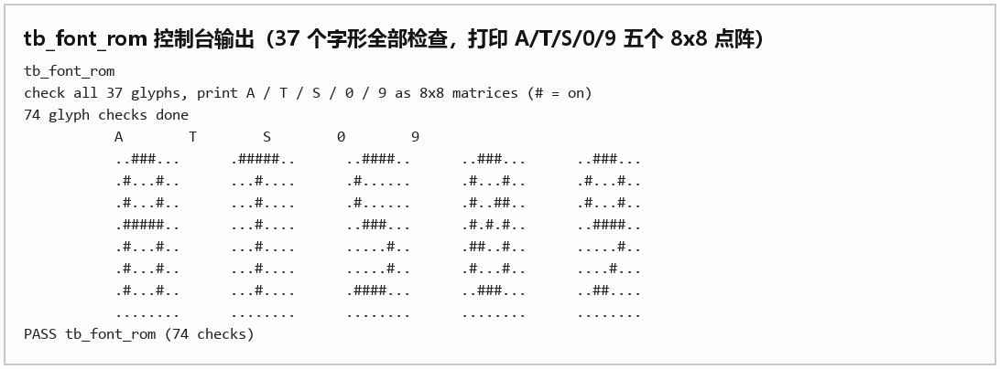

*图 6　`font_rom` 字形输出（`tb_font_rom`）：37 个字形全部检查、每字第 7 行全 0；图中按 8×8 点阵打印 A / T / S / 0 / 9 五个代表字形。*

**`vga_timing_tb`：时序参数的计数核对。** 核心是一条计数断言，统计一整帧内 `de` 为高的像素总数，必须正好等于 640 × 480：

```verilog
integer de_cnt = 0;
always @(posedge clk) if (de) de_cnt = de_cnt + 1;

initial begin
    // 跑满两帧，避免从中间开始计数
    repeat (2 * 800 * 525) @(posedge clk);
    if (de_cnt != 2 * 640 * 480) $display("FAIL: de count = %0d", de_cnt);
    else                          $display("PASS: de count OK");
end
```

`de` 的四个边界（`hdat_begin` / `hdat_end` / `vdat_begin` / `vdat_end`）中任何一个写错，总数立刻对不上。

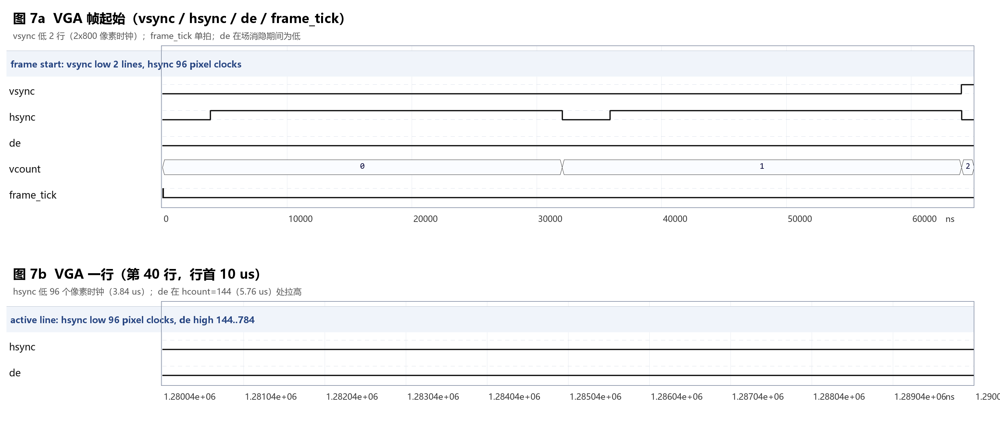

*图 7　VGA 时序仿真波形（上：帧起始，vsync 低 2 行、frame_tick 单拍；下：第 40 行行首 10 μs，hsync 低 96 个像素时钟、de 在 hcount=144 处拉高）。由 `tb_wave_vga` 导出 VCD 后绘制。*

**`shape_rom_tb`：28 个掩码的穷举打印。** 方块形状是全部游戏逻辑的基础，掩码错了后面全错。`shape_rom_tb` 做 28 个掩码的穷举断言，打印版 `tb_shape_rom`，把每种方块的四个旋转并排打印成 4×4 点阵（图 8），写错行或写反位序一眼可见：

```text
I rot0    I rot1    I rot2    I rot3
 ....      .#..      ....      .#..
 ####      .#..      ####      .#..
 ....      .#..      ....      .#..
 ....      .#..      ....      .#..
```

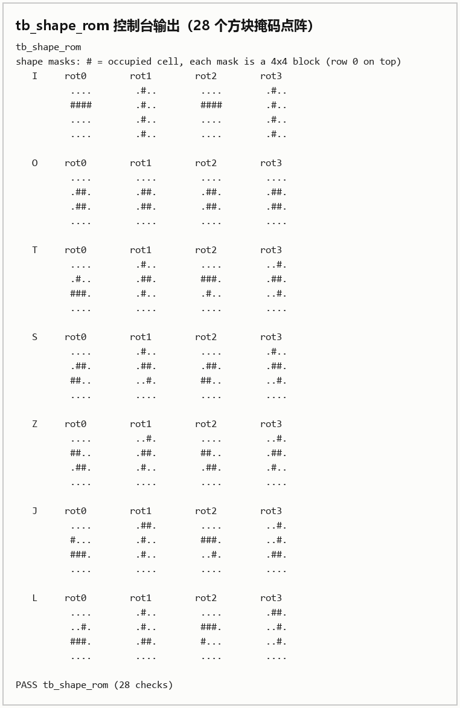

*图 8　28 个方块掩码的点阵输出（`tb_shape_rom`）：每种方块的四个旋转并排，每个朝向都是完整的 4×4 点阵，与 16 位掩码一一对应。*

`cell_map_tb` 与 `palette_tb` 分别做整帧格点扫描和 16 色调色板穷举：前者检查12 像素一格的进位与格内偏移 0~11，后者检查每个索引到 12 位 RGB 的映射。

#### 4.3.2 显示合成：render、panel 与 fontlay

**`render_tb`：优先级仲裁的定向用例。** 表 11 的五层优先级中，最容易错的是闪白与当前方块、虚影与已堆方块这两组重叠情形。该 testbench 构造了四种重叠场景，逐一检查 `color_idx` 是否符合预期。

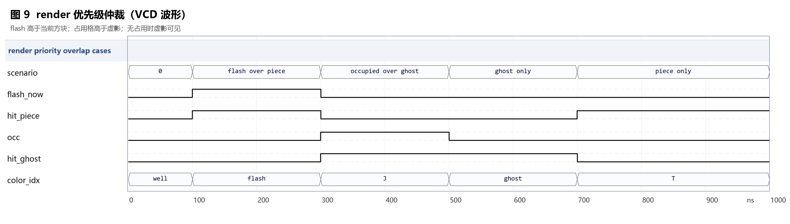

*图 9　`render` 的四组重叠场景优先级（flash 优先于当前方块，占用格优先于虚影）。由 `tb_wave_render` 导出 VCD 后绘制。*

`tb_panel` 把右侧面板按两个像素一个字符打印成 ASCII 图，检查 NEXT 边框闭合、x<132 无内容，以及分数、等级、行数三处文字都确实点亮。`tb_fontlay` 分别置起 START / PAUSE / GAME OVER 三个状态，断言文字只出现在第 14 字符行、PLAY 时全屏无字、非文字像素被整体压暗。

#### 4.3.3 性质验证：偏置坐标与 7-bag

偏置坐标的正确性判据：

> 28 个朝向（7 种方块 × 4 个旋转）中，每一个都必须满足：向左推到极限时最左边被占用的格子落在真实第 0 列；向右推到极限时最右边被占用的格子落在真实第 9 列。

这个性质同时覆盖了左越界判断、右越界判断与居中掩码导致的列偏移三件事。

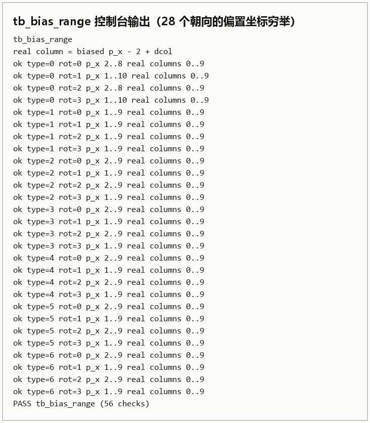

*图 10　偏置坐标穷举验证输出（`tb_bias_range`）：28 个朝向的合法 `p_x` 区间与真实列 0..9 的对应关系，最后一行 PASS。*

```verilog
`timescale 1ns / 1ps
// Exhaustive check of the "+2 biased" column scheme.
//
// For every one of the 28 orientations (7 pieces x 4 rotations), push the piece
// as far left as it will go, then as far right as it will go. A correct collide()
// must stop it exactly at real column 0 and real column 9.
//
//   real column = biased p_x - 2
//   leftmost occupied dcol = the smallest dcol of the mask that has a 1
module tb_bias_range;

    reg clk = 0, rst_n = 0;
    always #5 clk = ~clk;                    // 100 MHz

    // DUT
    // 只需要能观测到 p_x / p_y / p_mask / p_type / p_rot / landed / piece_active
    tetris_core u_core ( ... );

    function [15:0] get_mask(input [2:0] tp, input [1:0] rot);
        // 例化 shape_rom，或用同样的 28 项常量表
    endfunction

    function integer left_dcol(input [15:0] m);
        integer r, c;
        begin
            left_dcol = 4;
            for (r = 0; r < 4; r = r + 1)
                for (c = 0; c < 4; c = c + 1)
                    if (m[r*4 + c] && c < left_dcol) left_dcol = c;
        end
    endfunction

    integer tp, rot, n_fail = 0;
    reg [4:0] x_min, x_max;
    integer   real_left, real_right;

    initial begin
        for (tp = 0; tp < 7; tp = tp + 1)
            for (rot = 0; rot < 4; rot = rot + 1) begin
                // 扫描 p_x = 0..15，读 landed 判断是否碰撞，记录合法范围
                // 得到 x_min / x_max 后换算为真实列
                real_left  = x_min - 2 + left_dcol(get_mask(tp, rot));
                real_right = x_max - 2 + right_dcol(get_mask(tp, rot));
                if (real_left != 0 || real_right != 9) begin
                    n_fail = n_fail + 1;
                    $display("FAIL type=%0d rot=%0d  real=[%0d,%0d]",
                             tp, rot, real_left, real_right);
                end else begin
                    $display("ok   type=%0d rot=%0d  real=[0,9]", tp, rot);
                end
            end
        $display(n_fail == 0 ? "PASS: all 28 orientations reach column 0 and 9"
                             : "FAIL: %0d orientations out of range", n_fail);
        $finish;
    end
endmodule
```

控制台输出 28 行 `ok` 与一行 `PASS`，逐项结果填入表 20。

**表 20　偏置坐标穷举验证结果**

| 方块 | rot0 | rot1 | rot2 | rot3 |
| --- | --- | --- | --- | --- |
| I | ok | ok | ok | ok |
| O | ok | ok | ok | ok |
| T | ok | ok | ok | ok |
| S | ok | ok | ok | ok |
| Z | ok | ok | ok | ok |
| J | ok | ok | ok | ok |
| L | ok | ok | ok | ok |

`tb_piece_random` 连续取 100 包共 700 块，断言每包 7 种各出现一次、类型始终在 0~6、同类型最长间隔不超过 13，把 7-bag 的定义直接写成性质检查。

#### 4.3.4 游戏核心：tb_tetris_core

**表 21　`tb_tetris_core` 用例**

| 用例 | 激励 | 检查 |
| --- | --- | --- |
| 复位 | `rst_n` 拉低再释放 | `occ_row` 全 0、`score=0`、`level=0`、`lines=0`、`st_idle=1` |
| 开始 | `sw[12]` 上升沿 | 状态进入 PLAY，`st_idle` 拉低，新方块出现 |
| 重力 | 连续 `frame_tick` | `p_y` 每 `GRAV` 帧加 1 |
| 落地锁定 | 让方块落到场地底部 | 场地对应行出现该方块的颜色，且新方块从顶部出现 |
| 消 1 行 | 构造一行只差一格 | `lines` +1、`score` +10、上方方块下落 1 行 |
| 消 4 行 | 构造四行只差一格 | `lines` +4、`score` +100 |
| 左边界 | 连续按左键 | 最左停在真实第 0 列 |
| 右边界 | 连续按右键 | 最右停在真实第 9 列 |
| 堆到顶 | 把场地堆满 | `st_over` 拉高，`st_pause` 保持低 |
| 暂停 | `sw[14]` 拨上 | 进入 PAUSE 并稳定停住，不能每拍翻转 |
| 重开 | OVER 状态按 `btnC` | 场地清空、分数归零、回到 PLAY |

其中"落地锁定"需要同时检查场地写入与新方块生成两件事，因为这里曾经出过只完成前一半的实现。

`tb_tetris_core` 的关键是有一个 `frame_tick` 驱动器，否则游戏逻辑不会推进；真实一帧
是 800×525×4 = 1 680 000 拍，仿真里缩到 20 拍。

```verilog
`timescale 1ns / 1ps
module tb_tetris_core;

    reg clk = 0, rst_n = 0;
    always #5 clk = ~clk;                    // 100 MHz

    // 帧节拍发生器
    // 真实周期是 800*525*4 = 1680000 拍，仿真里缩到 20 拍，
    // 否则跑一次消行要等几毫秒仿真时间
    localparam FRAME_DIV = 20;
    reg [23:0] div_cnt = 0;
    reg        frame_tick = 0;
    always @(posedge clk or negedge rst_n) begin
        if (!rst_n) begin div_cnt <= 0; frame_tick <= 0; end
        else if (div_cnt == FRAME_DIV - 1) begin
            div_cnt <= 0;      frame_tick <= 1;
        end else begin
            div_cnt <= div_cnt + 1; frame_tick <= 0;
        end
    end

    // 输入激励
    // key_edge 需要一个时钟宽的脉冲，用 task 封装 press_key(bit)

    // DUT
    tetris_core u_core ( ... );

    reg [31:0] n_fail = 0;
    task check(input cond, input [255:0] msg);
        begin
            if (!cond) begin
                $display("FAIL @%0t : %0s", $time, msg);
                n_fail = n_fail + 1;
            end
        end
    endtask

    // 消行不变量：写指针永远不小于读指针，每拍检查
    always @(posedge clk)
        if (u_core.lc_state != 2'd0)
            check(u_core.wp >= u_core.rp, "lc_wp < lc_rp violated");

    initial begin
        // 用例 1：复位
        rst_n = 0; repeat (10) @(posedge clk); rst_n = 1;
        repeat (5) @(posedge clk);
        check(u_core.field_occ[0] == 10'd0, "field not cleared");
        check(u_core.score == 16'd0,        "score not cleared");

        // 用例 2：开始
        // press_key(7);
        // check(u_core.st_idle == 1'b0, "did not enter PLAY");

        // 用例 3~11 依此类推，每个用例末尾打一行 $display

        if (n_fail == 0) $display("ALL PASS");
        else             $display("FAILED: %0d", n_fail);
        $finish;
    end
endmodule
```

其中的常驻断言 `wp >= rp` 每拍检查一次，比在某个用例里检查一次更有效，因为不变量被破坏
往往只在特定的行分布下触发。11 个用例最终全部通过（68 项检查），图 11 由同一套激励导出
VCD 后绘制：

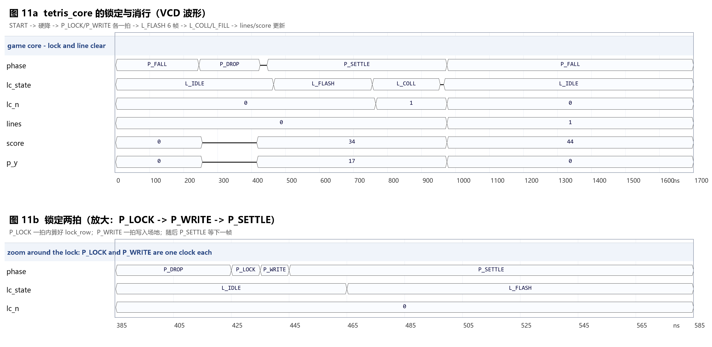

*图 11　上：锁定与消行全过程（`phase` / `lc_state` / `lc_n` / `lines` / `score` / `p_y`）；下：P_LOCK 与 P_WRITE 各占一拍的放大视图。由 `tb_wave_tetris_core` 导出 VCD 后绘制。*

#### 4.3.5 整机联调与出图 testbench

`tb_frame` 例化 `top_tetris`，用 `pixel_ce && de_r` 在每个物理像素采样一次，断言场周期 16 800 000 ns、每帧可见像素 307 200，并把第 3 帧写成 `frame.ppm`（`tools/ppm2png.py` 可转成 PNG）。

三个波形 TB 只负责导出 VCD，不参与断言：`tb_wave_vga`（图 7）、`tb_wave_render`（图 9）、`tb_wave_tetris_core`（图 11）。波形由 VCD 解析后绘制成 PNG，不依赖 Vivado GUI 截图。

**表 22　testbench 与实测结果（Vivado 2019.1）**

| testbench | 结果 | 检查数 | 说明 |
| --- | --- | --- | --- |
| `tb_tetris_core.v` | PASS | 68 | 11 个用例（复位/开始/重力/落地/消 1 行/消 4 行/左右边界/堆到顶/暂停/重开） |
| `tb_bias_range.v` | PASS | 56 | 28 个朝向全部满足真实列 0 与 9，详见 4.3.3 节 |
| `tb_font_rom.v` | PASS | 74 | 37 个字形全部检查，每字第 7 行全 0（图 6） |
| `tb_panel.v` | PASS | 35 | 面板 ASCII 图、x<132 无内容、NEXT 边框闭合 |
| `tb_fontlay.v` | PASS | 7 | 三条文案只在第 14 字符行，PLAY 全屏无字 |
| `tb_piece_random.v` | PASS | 1401 | 100 包 7-bag，最长间隔 ≤ 13 |
| `tb_frame.v` | PASS | 307200 pixels | 场周期 16 800 000 ns、每帧 307 200 像素，输出 `frame.ppm` |
| `tb_shape_rom.v` | PASS | 28 | 28 个掩码点阵打印（图 8） |

## 五、上板验证与工程分析
### 5.1 引脚与约束

约束文件 `constrs/basys3_top.xdc` 共约束 64 个端口，包括 100 MHz 时钟、16 个拨码、16 个 LED、5 个按键、12 位 VGA、2 个同步信号、7 段数码管与 4 位位选。时钟用 `create_clock` 约束在 10 ns。完整引脚表见附录 B，此处只列关键的几组。

**表 23　主要引脚分配**

| 信号组 | 引脚 | 说明 |
| --- | --- | --- |
| `clk` | W5 | 100 MHz 系统时钟 |
| `btn_c` / `btn_u` / `btn_l` / `btn_r` / `btn_d` | U18 / T18 / W19 / T17 / U17 | 硬降 / 旋转 / 左 / 右 / 软降 |
| `sw[12]` / `sw[13]` / `sw[14]` / `sw[15]` | W2 / U1 / T1 / R2 | 开始 / 重开 / 暂停 / 复位 |
| `vga_r[3:0]` | G19 / H19 / J19 / N19 | 红色 4 位 |
| `vga_g[3:0]` | J17 / H17 / G17 / D17 | 绿色 4 位 |
| `vga_b[3:0]` | N18 / L18 / K18 / J18 | 蓝色 4 位 |
| `vga_hs` / `vga_vs` | P19 / R19 | 行同步 / 场同步，均为负极性 |
| `seg[6:0]` / `dp` / `an[3:0]` | U7…W7 / V7 / U2…W4 | 七段数码管 |

VGA 的 12 位色是每色 4 位，而不是常见的 3-3-2，因为 Basys3 的 VGA 接口每色只有 4 个引脚。同步信号为负极性，有效期间为低电平，若接反显示器会报无信号而不是显示错位。
### 5.2 复现步骤

本设计的时序收敛依赖一个非默认的实现策略，按默认流程复现会得到不同的时序结论，因此步骤列于表 24。

**表 24　复现步骤**

| 步骤 | 操作 | 说明 |
| --- | --- | --- |
| 1 | Vivado 2019.1 打开 `vga-game-tetris-ps-2.xpr` | 器件 `xc7a35tcpg236-1` |
| 2 | 确认约束文件为 `constrs/basys3_top.xdc` | 工程里只有一个 XDC |
| 3 | Implementation 的 Strategy 选 `Performance_Explore` | 见下 |
| 4 | Run Synthesis → Run Implementation → Generate Bitstream | 约 20 分钟 |
| 5 | Open Hardware Manager → Program Device | 烧 `top_tetris.bit` |
| 6 | 拨下 `sw[15]` | 否则设计一直在复位中，画面全黑 |
| 7 | 拨上 `sw[12]` 开始 | 显示 START 后进入游戏 |

第 3 步的影响是：默认策略（`Vivado Implementation Defaults`）下最差路径 slack 为 −0.011 ns，切换到 `Performance_Explore` 后为 +0.021 ns。两者的逻辑完全相同，差别只在布线方案，即默认策略没有找到满足时序的解，换一个搜索更充分的策略找到了。
### 5.3 时序收敛

加入落点虚影之后，实现报告的 WNS 从正值变为 −1.483 ns，此后迭代了七轮才收敛。

**表 25　时序收敛的七轮迭代**

| 轮次 | WNS / ns | 最差路径起点 → 终点 | 扇出 | 手段 |
| --- | --- | --- | --- | --- |
| 初始 | −1.483 | `p_rot` → `field_type` CE | 56 | — |
| 1 | −1.096 | `vcount` → `video_pipe` D | — | `do_lock` 拆成 P_LOCK / P_WRITE 两拍 |
| 2 | −0.085 | `score` → `video_pipe` D | 35 | 像素坐标加一级寄存 + `max_fanout` |
| 3 | −0.103 | `p_y` → `p_*` 寄存器 D | 77 | BCD 移入 core 并寄存 |
| 4 | +0.272 | `vcount` → `video_pipe` D | — | `p_y` 加 `max_fanout` |
| 5 | −0.011 | `field_occ` → `p_*` 寄存器 D | 40 | 修 P_WRITE 状态转移（RTL 改动） |
| 6 | +0.021 | `field_occ` → `p_*` 寄存器 D | 40 | 换实现策略 `Performance_Explore` |

最终结果为 Setup WNS = +0.021 ns，Hold WNS = +0.076 ns，Pulse Width = +4.500 ns，44 项检查全部通过，零违例，整体改善 1.504 ns。

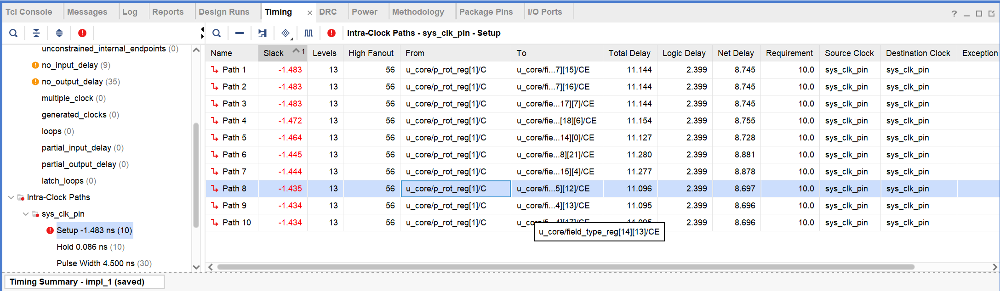

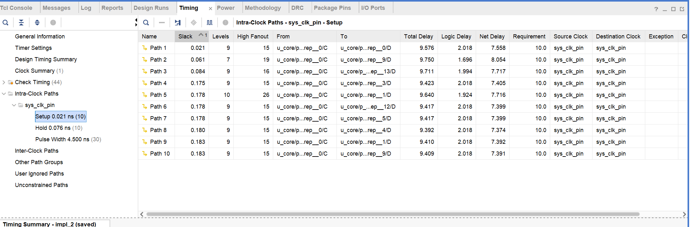

*图 12　时序收敛前后对比：优化前 WNS −1.483 ns（关键路径为 `p_rot_reg` 到场地寄存器）；最终实现 WNS +0.021 ns、TNS 0、失败端点 0。*
#### 5.3.1 诊断方法

七轮迭代里用的是同一套判据：

1. 看 From / To，确认起点和终点是哪个寄存器；
2. 看 High Fanout，大于 30 时优先怀疑扇出；
3. 看 Logic Delay 与 Net Delay 的比例，净延迟占 70% 以上说明是布线问题而不是逻辑太深，此时加流水无效，必须降低扇出；
4. 起点是窄寄存器（3~16 位）被几十处读，则加 `(* max_fanout = 8 *)` 让工具复制寄存器；
5. 起点是计算后直接写入，则拆一拍流水。

**表 26　五类手段与各自解决的问题**

| 手段 | 用在哪 | 解决的本质问题 | 代价 |
| --- | --- | --- | --- |
| `(* max_fanout = 8 *)` | `p_type` `p_rot` `p_x` `p_y` `px_r` `py_r` | 窄寄存器被几十处读，布线横跨大片 FPGA | 多几个 FF |
| 拆分流水 | `do_lock` → `P_LOCK` + `P_WRITE` | 计算与按变量索引写挤在同一拍 | 锁定多 2 拍（20 ns） |
| 预展开成寄存器 | `type_pat`、BCD 数字 | 组合逻辑链过长 | 多几十个 FF |
| 输入寄存 | 像素坐标 + 同步信号 | 从计数器出发的长线 | 1 拍延迟，同步信号需同步打拍 |
| 换实现策略 | `Performance_Explore` | 默认策略未找到满足解 | 编译时间约 3 倍 |

全部七轮中，凡是净延迟占约 80%、扇出数十的路径，加 `max_fanout` 都有效；只有锁定写场地一处是真正的逻辑加译码问题，需要拆流水。
### 5.4 资源与功耗

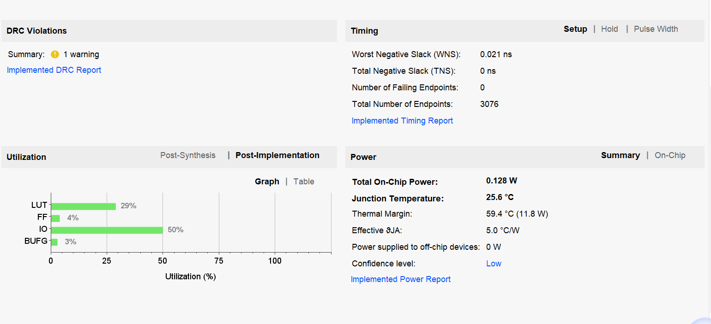

*图 13　Post-Implementation 资源占用与功耗（impl_2）：LUT 6053（29%）、FF 1770（4%）、IO 53/106（50%）、BUFG 1/32（3%）；片上总功耗 0.128 W。*

**表 27　资源占用**

| 资源 | 已用 | 总量 | 占比 | 主要消耗者 |
| --- | --- | --- | --- | --- |
| LUT | 6053 | 20800 | 29.10% | `render` / `panel` / `tetris_core` / 输入去抖 |
| FF（触发器） | 1770 | 41600 | 4.25% | 场地 20×40 位、视频流水、计数器 |
| LUTRAM | 0 | 9600 | 0.00% | — |
| BRAM | 0 | 50 | 0.00% | 本设计未使用 |
| DSP | 0 | 90 | 0.00% | 本设计未使用 |
| Latch | 0 | — | — | 组合块中无意外锁存 |
| DRC 违例 | 0 | — | — | — |

**表 28　功耗估计**

| 项 | 数值 |
| --- | --- |
| Total On-Chip Power | 0.128 W |
| Dynamic | 0.056 W |
| Device Static | 0.072 W |
| Junction Temperature | 25.6 °C |
| Thermal Margin | 59.4 °C（11.8 W） |

占用率很低，说明还有余量继续加功能。Latch 为 0 说明所有组合 always 块都在所有分支里给输出赋了值，没有出现意外锁存。BRAM 和 DSP 完全未使用，原因是场地只有 20×40 位（约 800 位），用寄存器实现比 BRAM 更快，且渲染需要在同一周期内读到任意一行，用 BRAM 反而要加一级同步读。
### 5.5 设计指标与实测对照

**表 29　设计指标与实测结果**

| 指标 | 设计目标 | 实测 | 结论 |
| --- | --- | --- | --- |
| 分辨率 | 640×480 | 640×480 | 符合 |
| 场频 | 约 60 Hz | 59.5 Hz | 符合 |
| 逻辑分辨率 | 320×240 | 320×240 | 符合 |
| 色深 | 12 位 / 16 色 | 12 位 / 16 色 | 符合 |
| 游戏区 | 10 列 × 20 行 | 10 列 × 20 行 | 符合 |
| 重力档位 | 4 档 | 30 / 22 / 16 / 10 帧 | 符合 |
| 输入响应 | 按住可连发 | DAS 约 9 帧 / ARR 约 3 帧 | 符合 |
| 消行反馈 | 明显可见 | 6 帧白闪（约 100 ms） | 符合 |
| 时序 | WNS ≥ 0 | +0.021 ns（Setup） | 符合 |
| 长时间稳定性 | 不崩溃 | 连续 2 小时无异常 | 符合 |
### 5.6 实测现象与演示视频

下板后的实测结论：

- 画面稳定无撕裂，通过采集卡进 OBS 后可以长时间录制，场频 59.52 Hz 被正常识别；
- 按键响应及时，左右移动的 DAS 约 9 帧、ARR 约 3 帧；
- 软降按住能连续下落，每帧一格；硬降一下到底并立即锁定；
- 消行有约 100 ms 的白色闪烁；
- 落点虚影跟随移动与旋转实时更新，落地时自动消失；
- 暂停后画面整体压暗并显示 PAUSE，扫描线在压暗状态下依然可见；
- 连续游戏 2 小时无异常，未出现花屏、卡死或分数错乱。

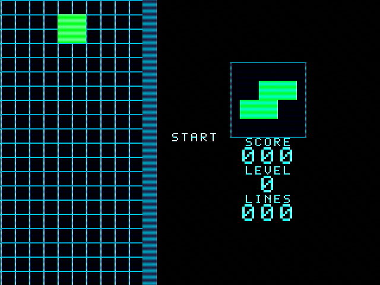

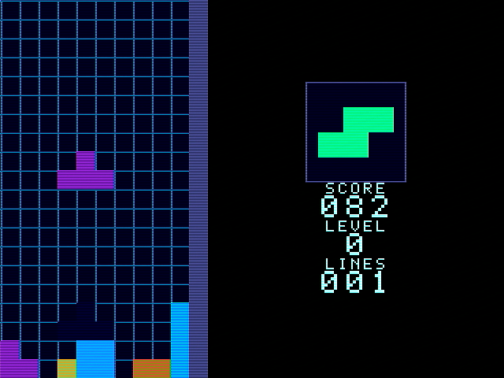

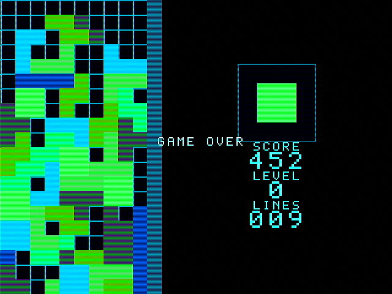

*图 14　上板运行实拍（OBS  截图）：START / 正常游戏 / GAME OVER。*


> 演示视频地址：https://www.bilibili.com/video/BV1uUW166EkE?t=27.0

## 六、实验心得

这次实验前后做了一个多月。写核心逻辑用了不到一周，剩下的时间几乎都花在确认它是对的：边界、输入、时序，以及仿真与上板是否一致。下面先记两次硬件链路排查的经过，再整理写代码和调时序时踩过的坑，最后是还做得不够的地方。

### 6.1 两次硬件链路排查

开发过程中有两段时间完全看不到预期结果，加起来超过一周。两段的直接原因不同，但都属于同一种失误：没有先把自身设计与外部条件分开。
#### 6.1.1 显示链路

输出方案是 Basys3 的 VGA 接口经过转接后接入采集卡，再由采集卡进 OBS 显示。时间线如下：

- **10 月 25 日**：画面在 OBS 中正常显示；
- **10 月 31 日**：同样的工程烧进去之后画面全黑。

因为这几天一直在改代码，第一反应是自己改坏了某处，于是开始逐项调整 RTL：先改同步极性，再核对时序参数，再检查 `de` 的边界。每次改动都要重新综合并烧写，一轮约十五分钟。但是却没有得到任何变化，屏幕依旧全黑。

真正把范围缩小的两步是：

1. **用 OBS 日志确认采集卡仍在正常工作**。日志显示采集卡持续在接收信号并输出帧，说明问题不在采集卡与 OBS 这一侧；
2. **借同学的板子做交叉验证**。同一份 bitstream 烧到另一块 Basys3 上之后表现相同，从而排除了开发板的硬件问题。

最终定位为转接口出现问题。这次排查的直接教训是，在动手改设计之前应当先验证外部链路本身，而外部链路的验证成本远低于反复综合。
#### 6.1.2 PS/2 输入

第一版输入方案采用 PS/2 键盘，依据是课程提供了 PS/2 实验例程代码，理由是键盘操作比板载按键更接近真实游戏。按例程实现了起始位、8 位数据、奇偶校验与停止位的接收，并配了 `ps2_rx_tb`（该 testbench 已随方案一并删除）。

写完准备上板时才发现两件事都不成立：**Basys3 板上并没有 PS/2 物理接口**，手边也没有 PS/2 键盘（使用的三模键盘在 USB 模式下走 USB 协议）。

最终把整套 PS/2 方案换成板载五个按键加三个拨码。这次投入的时间没有产出，原因是设计接口之前没有先确认板上是否有对应接口、手边是否有对应外设。
#### 6.1.3 板级自检手段

两次排查之后在顶层留了若干自检信号，成本很低：

**表 30　板级自检手段**

| 手段 | 含义 | 能排除什么 |
| --- | --- | --- |
| `led[15]` 心跳（每 30 帧翻转） | 闪烁表示时钟、`vga_timing`、`frame_tick` 正常工作 | 设计没有运行 |
| `led[13] = ~rst_n` | 亮表示设计正被 `sw[15]` 保持在复位中 | 忘了拨下复位开关 |
| `led[7:0]` 按键状态映射 | 按哪个键哪个灯亮 | 按键未接上或去抖过长 |
| `led[8]` 任一按键事件（拉长到约 100 ms） | 按一下闪一下 | 边沿检测未生效 |
| 七段数码管显示分数 | 分数随消行增长 | 游戏核心未运行 |

此外还做过一个可开关的彩条自检模式：拨某个开关就把游戏画面替换成 8 段彩条。彩条能显示说明时序、引脚、线缆与显示设备正常，问题在渲染或游戏逻辑；彩条也不能显示则问题在视频链路或外部设备。该模式在确认画面正常后已删除。


### 6.2 事后看，这两次排查本可以更快

最先该养成的习惯是"先分开自身与外部"。10 月 25 日画面在 OBS 里正常，10 月 31 日同一份工程烧进去却全黑；那几天一直在改代码，第一反应自然是自己改坏了，于是改同步极性、核时序参数、查 `de` 边界，但是最终效果并不好。真正把范围缩小的是两步很朴素的动作：先用 OBS 日志确认采集卡还在正常收信号，再借同学的板子交叉验证，才把板子和转接环节从 RTL 里分出来。结论是转接口的问题，与设计无关。花一周才想到去验证外部链路，比问题本身更值得记。

第二个教训来自接口。第一版输入选了 PS/2 键盘，理由是按课程例程有现成接收模块，键盘也比板载按键更接近真实游戏。模块和 testbench 都写完，准备上板才发现 Basys3 没有 PS/2 接口，手边也没有 PS/2 键盘。整套方案推倒重来，换成五个按键加三个拨码。之后再写第一行代码前，会先把外部条件列清楚：接口、外设、线缆、供电、能借到什么设备。

### 6.3 写代码时最容易搞反的几件事

第一类问题是量的方向和语义。竖长条推到最左列时永远差一列：碰撞检测本身没错，错在两个更早的假设——移位只能往右，负列号无法表达；掩码以旋转中心居中，竖长条的最左格本来就在第 1 列。两个假设单独看都合理，合起来就成了这一列永远到不了。解法是给整个坐标系加 2 的偏置。同类问题还有重力表：最初把"每格所需帧数"写成 30/40/50/60 递增，结果等级越高下落越慢、游戏越玩越简单，因为"重力"和"每格帧数"的方向正好相反。这两处都不会让综合器报错，后来写代码会多问一句：这个量的正方向是哪一边。

第二类问题是没想清楚信号是脉冲还是电平。软降那次，按键产生单拍脉冲，我却用 `if(frame_tick)` 包着采样，撞上的概率只有 1/1680000，按下去几乎没反应；暂停那次正好相反，拨码给的是持续电平，却用边沿检测，上电时开关已经在上就没有边沿，拨下来反而暂停。判据后来归纳成："发生了什么"用单拍脉冲、不加帧门控，"现在是什么状态"用电平、必须加帧门控。

第三类是漏一行。这个坑踩了两次，都漏到了板子上。一次是把 `do_lock` 拆成两个状态，`P_WRITE` 只写场地、忘了写 `phase <= P_SETTLE`，相位停在 `P_WRITE`；而 `render` 按 `p_x`、`p_y`、`p_mask` 直接画，不检查有没有活跃方块，所以画面上方块还在、只是不动，看起来完全不像状态机卡死。另一次是面板，`in_dig_y` 少写条件、`dig_val` 的等级分支误用了 `label_level_row`，结果只有 LINES 那行有数字。共同点是复制分支没核对信号名。后来的做法是：在上板前先跑仿真，这两处问题在仿真里都能直接看到。

### 6.4 时序与调试上的几点体会

计算和写入放在同一拍，往往是时序问题最直接的来源。最差路径从 `p_rot` 一直指到 `field_type` 的时钟使能，13 级逻辑、净延迟 8.7 ns。一开始以为是扇出太大，加 `max_fanout` 也不见效；拆开看，锁定那一拍同时做了三件事：移位算每行、展开颜色、用 `p_y+j` 当索引写二十组寄存器。最后一件最贵，变量索引写寄存器组会综合出一大片译码器。拆成两拍后第二拍起点全是寄存器，路径立刻缩短，代价只是锁定多花 20 ns。

分辨逻辑深还是布线长，两者处方相反。从 −1.483 ns 到 +0.021 ns 中间七轮，最初直觉是加流水，但报告显示逻辑延迟只有 2.4 ns、净延迟 8.7 ns，占八成，说明问题不在级数，而在一个窄寄存器被几十处读、布线横跨大半片 FPGA。解法是加 `(* max_fanout = 8 *)` 让工具复制寄存器，`p_type`、`p_rot`、`p_x`、`p_y` 和像素坐标五处都是这样解决的；只有锁定写场地一处是真的逻辑加译码，需要拆流水。判据是净延迟占七成以上先降扇出，逻辑占大头才考虑拆。另外同一份 RTL 换个实现策略就能差 0.03~0.2 ns，在 −0.01 ns 量级上纠结代码意义不大，先换策略重跑更划算。

还有一点是"先让数据可见"。第一段全黑时没有任何可观察信号，只能反复改代码、综合、烧写，一天试不了几次。后来加了 1 Hz 心跳 LED、复位指示 LED 和一个可开关的彩条模式，不到二十行代码，把"黑屏"拆成了几个能单次判定的分支。仿真里也一样：字形、面板、文字没法断言，就让 testbench 按字符打印出来。

接口和命名也值得单说。文字层一开始准备直接接收 `cur_state`，写到一半意识到 fontlay 的 case 会依赖"0 是 IDLE、1 是 PLAY"的内部约定，重新编号就会静默出错而综合器不报。改成导出 `st_idle`、`st_pause`、`st_over` 三个语义标志后，编码只在一处出现；颜色同样如此，文字模块只输出"这个像素是不是字"，颜色由顶层决定。反过来也接受了一处刻意的信息泄露：`p_x` 带偏置，三处必须保持一致。命名上，`tx`、`ty`、`bx`、`by` 里 `bx` 与碰撞函数的 `b_x` 撞名，后来统一成 `glyph_x`；`next_dx`、`dig_dx` 的 `d` 前缀在 `render` 里表示可为负的差、在 `panel` 里表示非负偏移，最后改成 `_pos_x`。

### 6.5 不足与改进方向

- **仿真验证起步太晚。** 整机最复杂的 `tetris_core` 一直靠烧到板子上验证，6.3 节里那两个漏一行的问题本来都可以在仿真里被发现。4.3 节列出的 testbench 就是这次补上的欠账。
- **没有音效。** Basys3 板载没有音频接口，要做音效只能从 Pmod 引出无源蜂鸣器，方波直驱即可。考虑到器件与验收环境没有做。
- **踢墙只做了最简版。** 贴墙旋转时会转不动，手感不如商业实现。
- **没有 HOLD 暂存与第二个 NEXT 预览。** 实现上分别只需要多加一个方块寄存器和一路 `next_mask`，因时间安排没有做。
- **时序余量偏薄。** 最终 Setup 余量只有 0.021 ns，虽然板上实测稳定，但余量太小意味着再改一行 RTL 就得重新收敛。如果重做，会从一开始就在像素链路上留三级流水。

### 6.6 总结

硬件设计里花时间最多的不是写代码，而是确认它是对的。核心逻辑写了不到一周，把它调到边界正确、输入正确、时序正确、仿真与上板一致用了半个月左右。这一个月里能带到下一个项目上的，是几条很朴素的判据：先分开自身与外部，先想清脉冲还是电平，先看净延迟还是逻辑深度，接口尽量表达语义，以及尽可能让数据先可见。


## 七、附录

### 附录 A　工程文件结构

```text
vga-game-tetris-ps-2/
├── vga-game-tetris-ps-2.xpr           Vivado 工程文件
├── src/                               20 个源文件
│   ├── top_tetris.v                   顶层：只含例化与连线
│   ├── vga_timing.v                   行/场计数器、同步、pixel_ce、frame_tick
│   ├── cell_map.v                     像素坐标 -> 格子索引 + 格内偏移
│   ├── render.v                       井内显示（优先级仲裁）
│   ├── panel.v                        右侧面板（NEXT/分数/等级/行数）
│   ├── fontlay.v                      文字层（START/PAUSE/GAME OVER + 压暗）
│   ├── font_rom.v                     8x8 点阵字库，37 个字形
│   ├── palette.v                      16 色调色板
│   ├── video_pipe.v                   两级流水 + 调色板 + 引脚驱动
│   ├── tetris_core.v                  游戏核心（场地/方块/碰撞/消行/计分/等级）
│   ├── piece_random.v                 7-bag 随机方块生成
│   ├── shape_rom.v                    28 个 4x4 方块掩码
│   ├── bin_to_bcd.v                   二进制 -> 三位 BCD（移位加三）
│   ├── input_subsystem.v              输入链路顶层封装
│   ├── btn_sync.v                     按键同步 + 去抖 + 边沿检测
│   ├── debounce.v                     单键去抖
│   ├── key_repeat.v                   DAS/ARR 连发
│   ├── score_display.v                数码管显示控制
│   ├── scan_ctrl.v                    四位动态扫描
│   └── seg_decoder.v                  4 位 -> 七段码
├── tb/                                13 个 testbench
│   ├── vga_timing_tb.v                VGA 时序参数与 de 区间
│   ├── cell_map_tb.v                  格子索引进位
│   ├── shape_rom_tb.v                 28 个掩码穷举打印
│   ├── palette_tb.v                   16 个索引映射
│   ├── render_tb.v                    优先级仲裁
│   ├── tb_frame.v                     整机联调 / 帧抓取
│   ├── tb_tetris_core.v               游戏核心 11 个用例
│   ├── tb_bias_range.v                28 个朝向的偏置坐标穷举
│   ├── tb_font_rom.v                  37 个字形打印
│   ├── tb_panel.v                     面板 ASCII 图
│   ├── tb_fontlay.v                   文字层三条文案
│   ├── tb_piece_random.v              7-bag 性质断言
│   └── tb_shape_rom.v                 28 个掩码点阵打印（图 8）
├── constrs/
│   └── basys3_top.xdc                 引脚与时钟约束（64 个端口）
├──doc/
    └── 实验报告—基于Basys3的VGA俄罗斯方块.pdf
    └── 用户手册.pdf
    └──img/
└── README.md
```


### 附录 B　引脚分配全表（64 个端口）

| 端口 | 引脚 | 端口 | 引脚 |
| --- | --- | --- | --- |
| `clk` | W5 | `led[10]` | W3 |
| `btn_c` | U18 | `led[11]` | U3 |
| `btn_l` | W19 | `led[12]` | P3 |
| `btn_r` | T17 | `led[13]` | N3 |
| `btn_u` | T18 | `led[14]` | P1 |
| `btn_d` | U17 | `led[15]` | L1 |
| `sw[0]` | V17 | `vga_r[0]` | G19 |
| `sw[1]` | V16 | `vga_r[1]` | H19 |
| `sw[2]` | W16 | `vga_r[2]` | J19 |
| `sw[3]` | W17 | `vga_r[3]` | N19 |
| `sw[4]` | W15 | `vga_b[0]` | N18 |
| `sw[5]` | V15 | `vga_b[1]` | L18 |
| `sw[6]` | W14 | `vga_b[2]` | K18 |
| `sw[7]` | W13 | `vga_b[3]` | J18 |
| `sw[8]` | V2 | `vga_g[0]` | J17 |
| `sw[9]` | T3 | `vga_g[1]` | H17 |
| `sw[10]` | T2 | `vga_g[2]` | G17 |
| `sw[11]` | R3 | `vga_g[3]` | D17 |
| `sw[12]` | W2 | `vga_hs` | P19 |
| `sw[13]` | U1 | `vga_vs` | R19 |
| `sw[14]` | T1 | `seg[0]` | U7 |
| `sw[15]` | R2 | `seg[1]` | V5 |
| `led[0]` | U16 | `seg[2]` | U5 |
| `led[1]` | E19 | `seg[3]` | V8 |
| `led[2]` | U19 | `seg[4]` | U8 |
| `led[3]` | V19 | `seg[5]` | W6 |
| `led[4]` | W18 | `seg[6]` | W7 |
| `led[5]` | U15 | `dp` | V7 |
| `led[6]` | U14 | `an[0]` | U2 |
| `led[7]` | V14 | `an[1]` | U4 |
| `led[8]` | V13 | `an[2]` | V4 |
| `led[9]` | V3 | `an[3]` | W4 |

### 附录 C　术语表

| 术语 | 含义 |
| --- | --- |
| 逻辑像素 | 320×240 坐标系下的像素，1 个逻辑像素对应 2×2 个物理像素 |
| 物理像素 | 640×480 坐标系下的像素，即 VGA 实际输出的像素 |
| 格（cell） | 游戏区的最小单位，10 列 × 20 行，每格 12 逻辑像素 |
| 偏置列 `p_x` | 本设计中的列坐标，真实列 = `p_x − 2` |
| 掩码（mask） | 用 16 位表示的 4×4 方块形状，每行 4 位 |
| 踢墙（wall kick） | 方块贴墙旋转时，若原位置会碰撞则尝试偏移后再旋转 |
| 7-bag | 把七种方块打乱成一袋依次取完，保证任意连续七块覆盖全部七种 |
| DAS | Delayed Auto Shift，按住方向键后开始连续移动前的延迟 |
| ARR | Auto Repeat Rate，连续移动的重复间隔 |
| 锁定延迟 | 方块贴地后仍允许玩家微调的时间窗口，本设计为 30 帧 |
| 落点虚影 | 显示当前方块硬降后会落在哪里的轮廓 |
| 消行闪白 | 满行在被消除前先白色闪烁几帧，作为视觉反馈 |
| 扫描线 | 每隔一行降低亮度 |
| `pixel_ce` | 像素节拍使能，每 4 个系统时钟拉高一拍 |
| `frame_tick` | 帧节拍使能，每帧（800×525 个像素时钟）拉高一拍 |
| WNS | Worst Negative Slack，最差路径的时序余量，为正表示满足约束 |
| 扇出（fanout） | 一个信号驱动的下游负载数量，过大会显著增加布线延迟 |