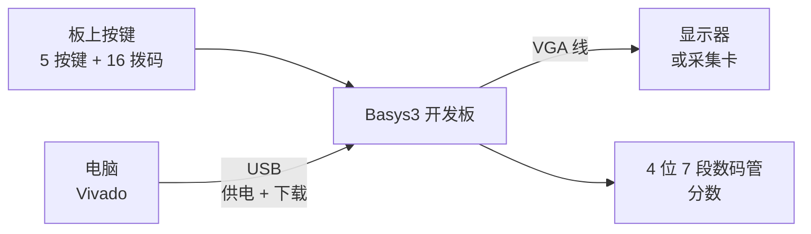
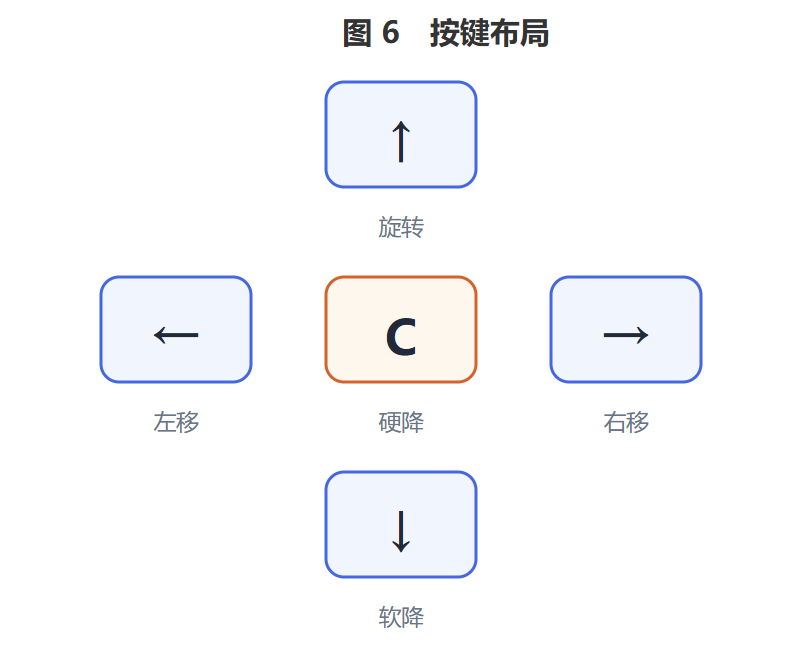
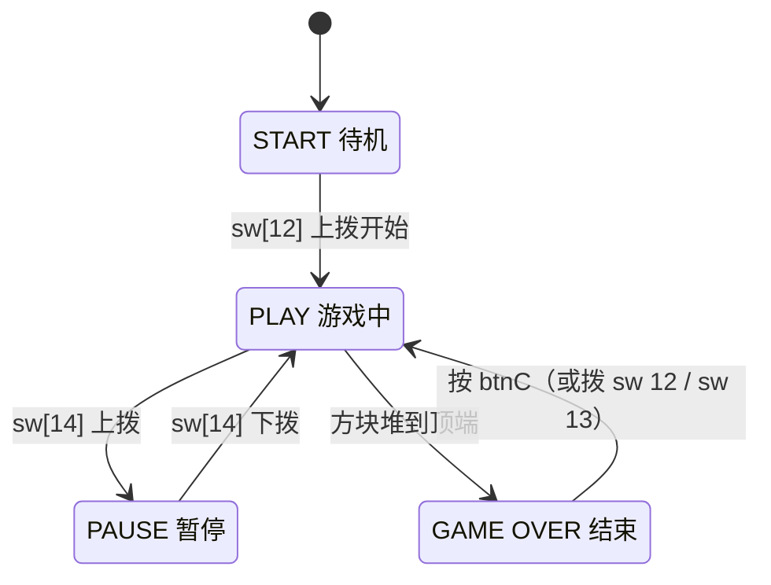
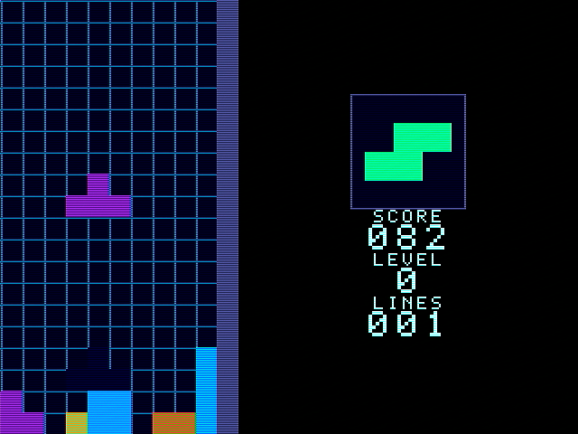
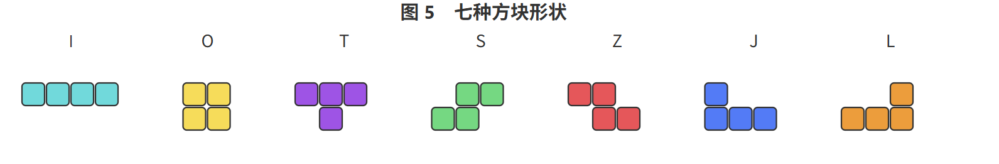
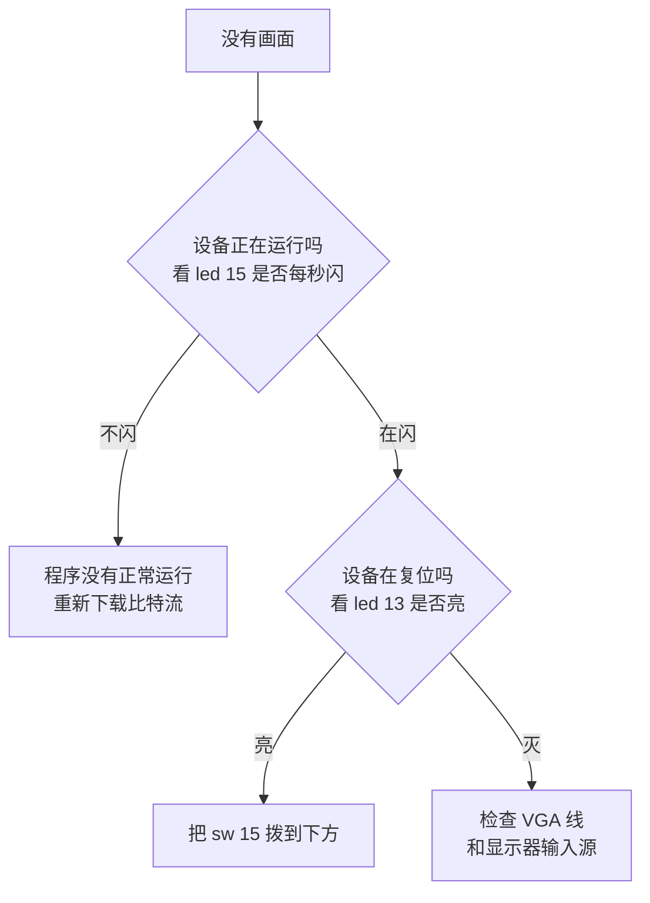

# Basys3 俄罗斯方块 用户手册

> **版本** 1.0　　**适用硬件** Digilent Basys3　　**日期** 2026-11

---

## 目录

1. 产品简介
2. 连接与上电
3. 操作说明
4. 界面说明
5. 游戏规则
6. 常见问题
7. 技术规格
8. 附录

---

## 1. 产品简介

本产品在 Digilent Basys3 开发板上实现了一个完整的俄罗斯方块游戏，
通过 VGA 接口输出画面，使用板上的 5 个按键和拨码开关操作。

### 1.1 主要特性

| 特性 | 说明 |
|---|---|
| 画面 | 640×480，16 色 |
| 游戏区域 | 10 列 × 20 行 |
| 方块种类 | 7 种 |
| 下一个方块预览 | 有 |
| 分数 / 等级 / 行数显示 | 有 |
| 落点提示 | 有（灰色轮廓）|
| 消行特效 | 有（满行白闪）|
| 按键连发 | 有（按住自动重复）|
| 暂停 / 重开 | 有 |
| 面板 7 段数码管 | 同步显示分数 |

### 1.2 包装内容

- Basys3 开发板 1 块
- 本手册 1 份

**需自备**：USB Micro-B 线（供电与下载）、VGA 线、显示器。

---

## 2. 连接与上电

### 2.1 接线

<b>图 1　接线与上电</b>

### 2.2 上电步骤

| 步骤 | 操作 | 预期现象 |
|---|---|---|
| 1 | USB 线连接 Basys3 与电脑 | 板上电源指示灯亮 |
| 2 | 接好 VGA 线到显示器 | — |
| 3 | 用 Vivado 下载比特流文件 | 下载完成后画面出现 |
| 4 | 确认 **`sw[15]` 在下方** | `led[13]` 熄灭 |
| 5 | 看到 `START` 画面 | 进入待机，可以开始 |

> ⚠️ **`sw[15]` 是复位开关，正常游玩时必须保持在下方。**
> 上拨会让画面变黑——这是最容易误判为"设备坏了"的情况。

### 2.3 使用采集卡

如果通过采集卡在电脑上观看：

| 设置项 | 值 |
|---|---|
| 分辨率 | 640 × 480 |
| 帧率 | 60 fps |

> 分辨率或帧率设错会导致画面**撕裂或上下滚动**。

---

## 3. 操作说明

### 3.1 按键（5 个）

<b>图 2　按键布局</b>

| 按键 | 功能 | 说明 |
|---|---|---|
| **左键** | 左移 | 按住会连续左移 |
| **右键** | 右移 | 按住会连续右移 |
| **上键** | 旋转 | 顺时针旋转；贴墙时会自动调整位置完成旋转 |
| **下键** | 软降 | 按住加速下落，每下落一格加 1 分 |
| **中键** | 硬降 | 直接落到底部并立即固定 |

### 3.2 拨码开关

| 开关 | 功能 | 用法 |
|---|---|---|
| **`sw[15]`** | **复位** | 上拨复位；**正常游玩时必须在下** |
| **`sw[14]`** | **暂停** | **上拨暂停，下拨继续** |
| **`sw[12]`** | **开始** | 上拨一次开始游戏 |
| **`sw[13]`** | **重开** | 上拨重开一局 |
| 其余开关 | 无功能 | 保持在下方即可 |

> **暂停状态下看开关位置就能判断**：`sw[14]` 在上就是暂停中，在下就是正在玩。

### 3.3 操作流程

<b>图 3　状态转换</b>

### 3.4 操作技巧

| 场景 | 推荐操作 |
|---|---|
| 只想微调一格 | 轻点左键或右键 |
| 要移动好几格 | **按住**左键或右键，会自动连续移动 |
| 想快速落底 | 按中键硬降 |
| 想边看边调位置 | 按住下键软降，随时松开 |
| 想看清会落在哪 | 参考方块下方的**灰色轮廓** |
| 临时离开一下 | `sw[14]` 上拨暂停，回来后下拨继续 |

---

## 4. 界面说明

### 4.1 整体布局

<b>图 4　界面布局</b>

### 4.2 各区域说明

| 区域 | 位置 | 说明 |
|---|---|---|
| **游戏井** | 左侧大区域 | 10 列 × 20 行，方块在这里堆叠 |
| **网格线** | 井内 | 每格边缘的细线，帮助判断对齐 |
| **NEXT 框** | 右上 | **下一个将要出现的方块** |
| **SCORE** | 右中 | 当前分数 |
| **LEVEL** | 右中 | 当前等级（0–3）|
| **LINES** | 右下 | 已消除的总行数 |

### 4.3 方块颜色

| 方块 | 颜色 |
|---|---|
| I | 青色 |
| O | 黄色 |
| T | 紫色 |
| S | 绿色 |
| Z | 红色 |
| J | 蓝色 |
| L | 橙色 |

同一个方块在井里和 NEXT 框里颜色相同。

### 4.4 辅助显示

| 显示 | 说明 |
|---|---|
| **灰色轮廓（虚影）** | 当前方块硬降后会落在哪里 |
| **满行白闪** | 一行填满后先白闪约 0.1 秒再消除 |
| **扫描线** | 隔行变暗的效果，模拟老式显示器 |

### 4.5 三种状态界面

| 状态 | 画面表现 |
|---|---|
| **START** | 画面变暗，中央显示 `START` |
| **PAUSE** | 画面变暗，中央显示 `PAUSE`，方块停止 |
| **GAME OVER** | 画面变暗，中央显示 `GAME OVER` |

**变暗只影响背景，文字始终清晰可读。**

### 4.6 数码管与指示灯

板上的 4 位 7 段数码管显示分数，与面板上的 SCORE 一致。

遇到问题时，下面两个指示灯最有用：

| 指示灯 | 含义 |
|---|---|
| **`led[13]` 亮** | **设备正在复位**（`sw[15]` 在上）|
| **`led[15]` 每秒闪一次** | **工作正常**（不闪说明设备没运行）|

其余的 LED 显示按键和开关的实时状态，仅供调试参考。

---

## 5. 游戏规则

### 5.1 基本玩法

方块从井顶自动落下。用按键把方块移动、旋转到合适的位置，
让它们尽量紧密地堆叠。

一行被完全填满时，该行消除，上方的方块整体下落一行。

**下一个方块是什么，看右上角的 NEXT 框。**

### 5.2 计分

| 一次消除 | 得分 |
|---|---|
| 1 行 | 10 分 |
| 2 行 | 30 分 |
| 3 行 | 60 分 |
| **4 行** | **100 分** |

| 操作 | 得分 |
|---|---|
| 软降每下落一格 | +1 分 |

> **一次消四行比消四次一行得分高得多**（100 对 40），
> 所以堆积起来一次消除比随时消除更划算。

分数达到 999 后显示不再增加。

### 5.3 等级与速度

每消除 **10 行**升一级，方块下落速度加快：

| 等级 | 已消行数 | 下落速度 |
|---|---|---|
| **0** | 0–9 | 慢（约 0.5 秒一格）|
| **1** | 10–19 | 稍快 |
| **2** | 20–29 | 快 |
| **3** | 30 及以上 | 最快（约 0.18 秒一格）|

等级显示在面板 `LEVEL` 处，最高 3 级。

### 5.4 游戏结束

当新方块在顶部出现的位置**已经被占住**时，游戏结束。

此时按中键（或拨 `sw[12]` / `sw[13]`）可以开始新的一局，
场地清空、分数归零。

### 5.5 方块形状

<b>图 5　七种方块形状</b>

每种方块都可以旋转成 4 个方向。

> 方块的种类会均匀出现，不会长时间反复出现同一种。

---

## 6. 常见问题

### 6.1 显示问题

| 现象 | 可能原因 | 处理方法 |
|---|---|---|
| **完全没有画面** | VGA 线没接好 / 未下载程序 | 检查线缆；重新下载 |
| 画面全黑 | `sw[15]` 在上（复位中）| **把 `sw[15]` 拨到下方** |
| 画面撕裂 / 上下滚动 | 采集卡分辨率或帧率不匹配 | 设为 640×480 @ 60 |
| 画面颜色异常 | VGA 线接触不良 | 重新插拔 |
| 画面整体偏暗 | 处于 START / PAUSE / GAME OVER 状态 | 正常现象，开始游戏后恢复 |

### 6.2 操作问题

| 现象 | 可能原因 | 处理方法 |
|---|---|---|
| 一直显示 START，按键没反应 | 没拨 `sw[12]` | 上拨 `sw[12]` 开始 |
| 方块不动 | `sw[14]` 在上（暂停中）| 下拨 `sw[14]` |
| 按键偶尔没反应 | 按下时间太短 | 稍用力按久一点 |
| 数码管一直显示 000 | 分数为 0 | 正常，消行后才有分 |
| 面板数字一直不变 | 还没消行 | 正常 |

### 6.3 排障速查

<b>图 6　排障速查</b>

---

## 7. 技术规格

| 项目 | 参数 |
|---|---|
| 显示分辨率 | 640 × 480 |
| 刷新率 | 约 60 Hz |
| 颜色 | 16 色 |
| 视频接口 | VGA（DE-15）|
| 供电接口 | USB Micro-B（5 V）|
| 游戏区域 | 10 列 × 20 行 |
| 方块种类 | 7 种 |
| 等级 | 0 – 3 级 |
| 最大显示分数 | 999 |

---

## 8. 附录

### 8.1 术语表

| 术语 | 含义 |
|---|---|
| **井** | 方块堆积的游戏区域（10 列 × 20 行）|
| **硬降** | 方块直接落到底部并立即固定 |
| **软降** | 按住加速下落，可以随时停止 |
| **踢墙** | 贴墙旋转时，方块自动错开位置以完成旋转 |
| **虚影** | 显示方块落点的灰色轮廓 |
| **消行** | 一行填满后该行消失，上方方块下落 |
| **NEXT** | 下一个将要出现的方块 |

### 8.2 修订记录

| 版本 | 日期 | 说明 |
|---|---|---|
| 1.0 | 2026-11 | 首次发布 |

### 8.3 作者

- 姓名：陈诺
- 学号：25303040030
- 课程：荣誉课作业 4（数电）

---

